# Full FAQ - Acultur8 FM-1 kick prerelease

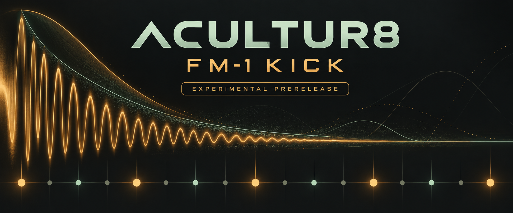

**Version:** 0.1.60-stoppedtrace / FM-1_9000160. This is an experimental prerelease.

[Documentation](README.md) · [Feature comparison](FEATURE_COMPARISON.md) · [Complete CC/MIDI map](CC_MIDI_MAP.md) · [Tutorials](tutorials/README.md)

## What is included in this prerelease?

Hybrid 808 kick shaping and velocity expression, native preset STORE/RECALL, existing long-tail retrigger handling, and a selected Favorite Slot 1 starter preset. The wider Acultur8 engine remains present; this release's physical checks focus on the kick and representative workloads. Version .60 additionally retains dropout diagnostics from blocks that start while stopped.

## Is it a stable, universally dropout-free release?

No. One tested FM-1 completed a user-timed 25-minute complex P11 run with 0 dropouts and 0 guard engagements. Physical core1 stack and broader deadline coverage remain unmeasured. Two earlier .59 counter events remain unexplained and did not recur in controlled .60 checks. This is bounded observation, not a guarantee for every pattern, MIDI setup or automation combination.

## What did the checks cover?

135 required engine checks, including 39 host scenarios; six additional kick groups; focused .60 capture/decoder/paired-record tests; exact PCM/state comparisons; unchanged target gates and byte-identical target rebuilds. Physical checks included quiet listening, filter and limiter sweeps, overlapping long tails, native STORE/RECALL, normal restart preservation and a separate starter-preset audition. Host/WASM tests do not establish physical device deadlines or wire timing.

## Did any limits change to make the tests pass?

No. All 15 original target gates remain unchanged. The IRQ wrapper is 83 instructions against the original limit of 85. Guard thresholds, sample rate and buffer sizes were not increased. The measured IRQ stack high-water was 1,092 / 7,936 bytes for the tested workloads; that is not a physical core1 or whole-system stack bound.

## Where are the update and recovery instructions?

Read [safe update and recovery](tutorials/01_SAFE_UPDATE.md) and [INSTALL_RECOVERY.txt](../INSTALL_RECOVERY.txt). Stop playback, turn MASTER fully down, preserve compatible backups and verify package hashes before updating. A restore replaces project data and is never an automatic troubleshooting step.

## Does installing firmware install the starter preset into my slot 1?

No. Your native preset bank is yours. The starter ZIP contains portable JSON, its exact native record and a native-control reference. Use an empty destination when entering/storing a new sound. There is no automatic JSON importer or mod-pack loader in this scope; do not flash a preset record or restore another user's project as a preset installation method.

## What does a kick preset contain?

39 hybrid parameters, the original ten 808 BD parameters, the kick's six strip fields and an optional custom-sample fingerprint reference. It does not contain patterns, shared kit/global FX or sample audio. Native slots are numbered; exported JSON can have a name. Missing or changed USER1 audio can refuse a recall.

## Are project Save and STORE KICK the same?

No. Project Save keeps the current project. KIT → STORE KICK writes a reusable kick record to the selected native slot. RECALL KICK applies a stored sound to the current project; save the project if you intend to retain that recall. Native STORE/RECALL require stopped playback and a finished tail, and ask for confirmation. [Preset tutorial](tutorials/02_PRESETS.md).

## Why do W DECAY values in the map differ from the screen?

The stored range is 0–127; WAVE ENV displays milliseconds using `5 + raw × 2995 / 127`, with integer display rounding down. Raw 75 displays 1,773 ms. The separate WAVE SHAPE W DECAY is a different control. Favorite Slot 1's WAVE ENV decay is raw 5, displayed as 122 ms. The earlier test sound used 405 ms; those are not interchangeable preset values.

## How do I hear the long-tail retrigger behavior?

Use a quiet level and a backed-up test sound. A WAVE ENV decay longer than the time between hits exercises overlapping retriggers. At 134 BPM, quarter notes are about 448 ms apart; the scoped test used 1,773 ms. That does not mean every sound needs a long decay. Restore captured values after testing. [Shaping tutorial](tutorials/03_KICK_SHAPING.md).

## Is the full MIDI/CC map included?

Yes: all 803 inventory rows are included as [Markdown](CC_MIDI_MAP.md), [searchable HTML](CC_MIDI_MAP.html), [CSV](CC_MIDI_MAP.csv) and [JSON](CC_MIDI_MAP.json). The native map remains `draft-2-kick-presets-1`, kick ABI KP01. The guide separates assigned addresses, native-only entries, browser-only proposals and guard requirements. An inventory row is not a claim of complete live DAW acceptance.

## Can every CC be sent freely while playing?

No. Read the row's binding, runtime status, context and action policy. Preset actions and other guarded operations have stopped-state and ownership requirements. Optional CC14 is a proposal where labelled, not an implemented promise. GLO CC MODE is selected natively. [MIDI tutorial](tutorials/04_MIDI_CC.md).

## Which features are inherited, new, deferred or only locally qualified?

The [feature comparison](FEATURE_COMPARISON.md) compares the pinned public .32 prerelease with the reviewed .60 source, preserving upstream credit. It distinguishes older Acultur8 features from kick additions and from physical acceptance. Native Tightness Factor and the mod-pack loader are deferred; no new Pages deployment or complete DAW certification is implied.

## Why is there a large older FAQ below?

The complete earlier illustrated project FAQ is retained for reference, including its diagrams, tables and planning topics. Its dated checkpoints, future-tense sections and earlier publication status are historical. The current prerelease sections above and linked comparison/map take precedence for current scope. Browser/server routes in historical material are not evidence that a new website was deployed.

---

# Complete earlier illustrated project FAQ (historical reference)

Acultur8 X0X • Development and REX FAQ

[← Back to development targets](../lab/static/index.html#targets)

ACULTUR8 / FM1 LAB

## Build the variant. Keep the groove.

What works today, what we are building next, and how to test your REX loops. The release plan starts with a playable browser alpha and progresses toward a verified FM1 firmware variant.

### GitHub source updates authorized; Pages publication held

The user authorized keeping GitHub source and documentation current. Reviewed changes may merge after required checks pass. New Pages deployments remain disabled pending separate sign-off. The existing public repository and previously published site remain visible; this notice does not make them private.

[Illustrated feature guide](#feature-guide)[Publication status](#publication-hold)[Release plan](#release-plan)[Next development steps](#expedited-plan)[Whole-song test](#demo-check)[New features](#new-features)[GitHub & hosting](#github)[Test a loop](#start)[Timing explained](#timing)[Tempo sync](#sync)[Import files](#files)[Limits](#limits)[CV/gate · guitar analogy](#guide-cv-gate)

ILLUSTRATED FEATURE GUIDE / LOCAL DEVELOPMENT

### One engine. Separate sounds, chords and loops.

These diagrams explain the shared behavior once, then show the cases that differ. The bass-only figures in this introductory paragraph are historical; see Latest local development checkpoint for the current combined build. Sound-strip browser functionality and basic arrangement have recorded acceptance. The bass-follow candidate passes source review, the fresh local host/WASM regression suite and actual local browser GUI checks. Its target image is 581,524 / 581,564 bytes (40 bytes spare), with all 15 unchanged original static gates passing. Complete external MIDI scene, 30-minute soak, receiver delivery, human listening and physical qualification remain pending. Earlier release checkpoints below are retained as history.

[All 25 sounds](#guide-sounds)[Boost & ceiling](#guide-ceiling)[808 paired tails](#guide-pairs)[Arrange blocks](#guide-arrangement)[Chords & bass](#guide-harmony)[Slice tempo](#guide-slices)[Separate saves](#guide-saves)[Planned MIDI pad](#guide-midi)

#### 1 · Which sounds have their own strip?

##### 909 · 11 sounds

- BD · Kick

- SD · Snare

- LT · Low tom

- MT · Mid tom

- HT · High tom

- RS · Rimshot

- CP · Clap

- CH · Closed hi-hat

- OH · Open hi-hat

- CR · Crash

- RD · Ride

##### 808 · 11 sounds

- BD · Kick

- SD · Snare

- LT · Low tom

- MT · Mid tom

- HT · High tom

- RS / Clave

- CP / Maracas

- CB · Cowbell

- CY · Cymbal

- OH · Open hi-hat

- CH · Closed hi-hat

##### 303 · 2 bass parts

- 303 A

- 303 B

##### BREAK · 1 instrument part

- Mono instrument BREAK

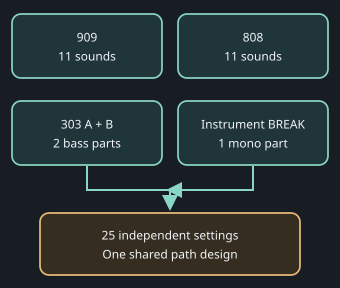

The controls select a sound; they do not copy its settings to every voice. **Marked-WAV preview is a separate playback lane.**

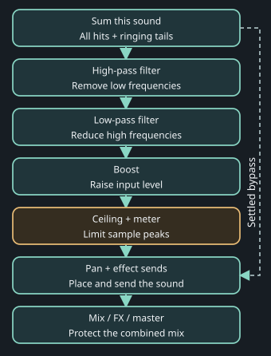

Enable only the stages you want. **Settled bypass preserves the original sound.** A per-sound ceiling acts before the shared mix, effects and master protection.

#### 2 · What does Boost do to the ceiling?

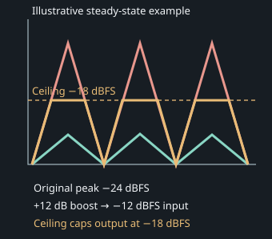

**Illustrative steady-state example, not an exact transient or true-peak model.** Turquoise: original signal. Coral: boosted input. Gold: bounded output. **Boost and ceiling are different controls.** The meter shows gain reduction; release can change the shape between peaks.

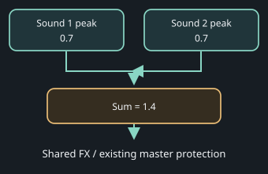

Separate mixing example: two aligned peaks near 0.7 each (about −3 dBFS per sound) can sum to 1.4. This uses different settings from the −18 dBFS example. Several sounds and effect returns can add together above full scale. Keep the master protection. This is a **sample-peak** limiter: no lookahead, true-peak or physical CPU headroom claim.

#### 3 · Why do paired 808 sounds share a ceiling?

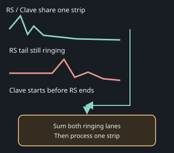

The same rule applies to **CP / Maracas**. The active selected sound supplies Rev/Dly sends. The ceiling bounds the pair’s combined output, not each tail in isolation.

#### 4 · Which block am I editing, hearing or waiting for?

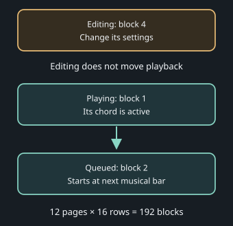

Each block assigns patterns, mutes, a chord degree and **1–8 four-quarter-note bars**. A queued transition uses the next bar boundary. Short or odd-length patterns keep their own cycles; broader insertion/order/loop controls remain pending.

#### 5 · How do degrees become chords and bass notes?

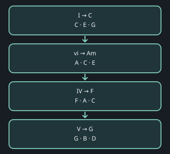

Example: **key C + Ionian + I–vi–IV–V → C–Am–F–G**. Mode supplies chord qualities; degree chooses the root. The shared engine resolves the notes. Pentatonic needs an explicit seven-note parent; chromatic does not invent seven diatonic degrees.

| Degree | Chord | Chord tones |
| --- | --- | --- |
| 1 · I | C major | C · E · G |
| 2 · ii | D minor | D · F · A |
| 3 · iii | E minor | E · G · B |
| 4 · IV | F major | F · A · C |
| 5 · V | G major | G · B · D |
| 6 · vi | A minor | A · C · E |
| 7 · vii° | B diminished | B · D · F |

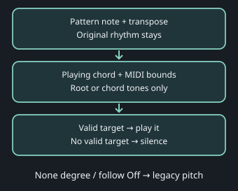

On a C chord, Root accepts **C**; Chord accepts **C, E or G** in allowed octaves. A range containing only MIDI 61 (C♯) has no valid C-chord target: strict follow emits no note. **TIE cannot revive a rejected note; a new NOTE is required.** Slide targets obey the rule; intermediate glide pitches are intentional.

**Bass candidate boundary:** local native/source review, fresh host/WASM and actual GUI checks pass. Browser checks cover follow editing, range rejection, undo/redo, save/reopen, live-play locks, queued chords, generated held notes, strict MIDI 61–61 silence and slice sync at 90/120/180 BPM. The firmware image fits at **581,524 / 581,564 bytes (40 bytes spare)**; all 15 unchanged original static gates pass. These results do not establish worst-case physical CPU, a complete external MIDI scene, a 30-minute soak, receiver delivery or human listening acceptance. Generators/mutation, accents, rhythm and saved absolute notes retain their existing roles; follow resolves final playback targets rather than rewriting patterns. A later reviewed local text-helper optimization reduces the target image to 578,244 / 581,564 bytes (3,320 bytes spare), with RAM/pool unchanged and all 15 original gates passing. Eight native scenarios retain 44 rendered images and 1,426,176 stereo audio frames exactly; physical drawing timing remains pending. External accompaniment and actual browser MIDI routing are now being implemented locally, with their integrated checks still pending; no internal pad sound is claimed.

#### 6 · Does changing tempo also change the pitch?

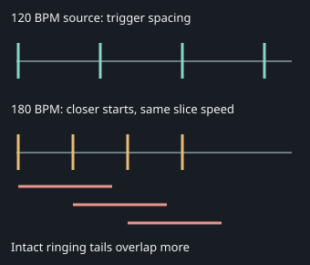

Faster tempo brings triggers closer; slower tempo can reveal gaps. Slice speed, pitch and tails stay intact. A 7/8 loop retains its 3.5-quarter-note cycle. **Marked-WAV preview/import storage is separate from the instrument’s mono BREAK part and its strip.**

#### 7 · Which Save keeps which work?

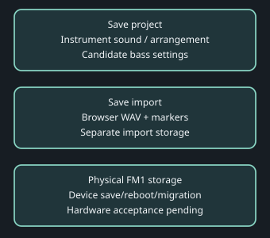

Use **Save project** for instrument settings and **Save import** for the imported loop. Stop before protected project edits/save. Browser saved reopen does not establish hardware save/reboot or interrupted-save behavior.

#### 8 · Where will external pad accompaniment fit?

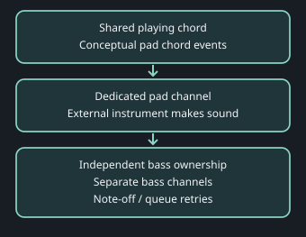

Pad accompaniment is **planned, not implemented sound**. Separate bass channels allow independent attacks. A full queue can delay cleanup; retries must release the owned note and must not revive a note after stop. Engine MIDI transport readiness is not proof of a browser MIDI port or physical receiver delivery.

### What can I use now?

AVAILABLE LOCALLY

#### Listen and experiment

Source editing with checkpoints, the browser emulator, WAV/slice-marker import, optional separately configured Windows REX conversion, original timing and pitch-preserving sequencer sync are implemented.

PLANNED

#### Shape and arrange

The opt-in 909 kick filters, boost and ceiling are available. Basic arrangement and harmony metadata are publicly accepted. All-25 processing passes the complete fresh mandatory suite and actual local browser GUI acceptance; hosted publication, broader arrangement controls, chord-following bass and pad accompaniment remain pending.

RELEASE CHECKS OPEN

#### Share and play on FM1

The public fork, portable setup and browser hosting passed acceptance. Physical FM1 qualification remains pending. Browser audio performance does not measure device CPU headroom.

### What is the quickest release route?

- A · BROWSER ALPHA**Available now**Public fork, portable lab, mandatory CI, synthetic slices and tempo sync.Published and accepted

- B · SOUND CONTROLS**Shape each sound**Fonts and resource budget, shared commands/saves, one complete kick, then all sounds.Forecast: 4–7 focused days from resumption

- C · ARRANGEMENT**Follow the chords**Blocks, progression, both basses, external MIDI and whole-scene acceptance.Forecast: 8–12 days from resumption

- D · DEVICE CANDIDATE**Prove it on FM1**Physical resources, audio/USB/MIDI, clock, storage and recovery acceptance.Pending hardware; no fixed date

These are planning estimates, not release dates. The sound and musical windows overlap because independent work can proceed in parallel. Memory redesign or failed acceptance extends the forecast. Hardware qualification depends on the device, toolchain and measured results. An internal pad and hardware sample transfer have separate follow-up estimates.

### What are the top ten development priorities?

- Lossless fonts and firmware build headroom.

- Combined audio and RAM/pool baseline.

- Acknowledged editing commands and compatible saves.

- One complete editable 909 kick strip.

- Filters, boost and ceiling across all 25 strips.

- Paged arrangement blocks and transitions.

- Key/scale chord progression.

- Both chord-following bass generators.

- External MIDI pad accompaniment.

- Complete musical browser scene and soak.

The [development targets](../lab/static/index.html#targets) give each work item its milestone, dependencies, next check and acceptance criteria. The [development history](../lab/static/index.html#notes) records completed work and planning decisions. The detailed local plan is `ACULTUR8_VARIANT_PLAN.md` in the dashboard folder. Completed emulator and REX targets remain accepted within their recorded browser/local scope.

### What passed for the first GitHub alpha?

- **Prepare the variant:** the public fork and upstream history are preserved; all 230 baseline files match. Review the imported source changes before merging.

- **Make it portable:** launch the local lab from a fresh clone, with configurable paths and an optional local converter.

- **Prove the package:** run required host, browser-audio and dashboard checks; test a synthetic loop, save/reopen and tempo sync under the actual hosted URL prefix.

- **Publish the tested commit:** include source, credits, setup instructions, build checksums and a playable browser demo. Promote an installable firmware release only after the separate device checks pass.

Reviewed PRs #1–#3 are merged. The portable lab and mandatory CI passed. [Browser alpha.1 is live](https://keyboy250.github.io/fm1-x0x-acultur8/): its six-slice demo passed import, 90/120/180 BPM sync, stop/restart and save/reopen checks. All 21 deployed files matched their build hashes. [Release and exact source](https://github.com/keyboy250/fm1-x0x-acultur8/releases/tag/acultur8-v0.1.0-alpha.1).

The first firmware build leaves only **120 bytes of image space and 1,088 bytes of general RAM**. Browser work can continue, while measured size reductions and real-device timing remain required for physical FM1 qualification.

### Latest local development checkpoint

The qualified resource checkpoint is merged in PR19 after GitHub CI passed: 580484/581564 image bytes, 98272/98304 ordinary RAM and 335712/344064 pool bytes, with all fifteen original static gates passing. The browser slice candidate preserves all 693 registry rows and adds source2/HOST controls for all thirteen marked-audio operations; native USB/TRS slice bindings stay unsupported. Its fresh combined nine-check suite, including seven new mandatory engine/UI/HTTP/coverage checks, passes after the packaging assertions were updated for the shared storage service. The integrated genuine-browser IndexedDB harness also passes all thirteen paths. These results do not establish real AudioContext, DAW/device, download delivery, hearing or full-performance acceptance.

New-action browser GUI, real DAW/receiver, hearing/click, long-soak, physical timing/stack and flash crash acceptance remain open. Previous browser scene evidence below belongs to its original engine. Source updates are authorized; Pages remains held. See [the MIDI editing diagram](#guide-midi-actions).

Previous qualified parameter-table and browser-scene checkpoint

The reviewed lossless parameter-table encoding passes all 15 original static target gates. The combined image uses 579172/581564 bytes, general RAM 98184/98304 and pool 335712/344064. That leaves 2392 image bytes, 120 general-RAM bytes and 160 pool bytes above the reserve. The fresh integrated candidate passed all nine mandatory software checks, including exact sound-table comparisons. Actual browser checks on this engine passed MASTER readback, a synthetic drum/bass/BREAK scene with independent hat timing and slices at 125/90/180 BPM, shared Stop and saved settings/import reopening. These are partial scene checks: human listening, external MIDI delivery and a long soak still need acceptance. Complete MIDI coverage, real DAW and receiver delivery, continuous-click diagnosis, the full musical scene and physical timing remain open. Earlier candidate figures below are historical checkpoints. Browser Pages publication awaits sign-off; GitHub source updates are authorised.

### Can the MASTER knob follow DAW automation?

The local development candidate maps the main output level to MIDI channel 13, controller 76: zero is mute and 127 is full level. This is separate from the MASTER effects bank. Browser knob movement immediately takes control and reads back the engine value. On the device, the proposed pickup policy holds the automated level until you deliberately move the physical knob near or through that level. A stationary knob and small jitter retain automation, including mute. Disconnecting the controller retains the last level.

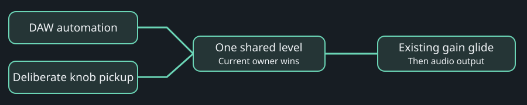

This level is a runtime control: it is not a saved sound preset or part of project Undo. Native pickup traces and browser-engine tests pass; actual hardware pickup and DAW delivery remain pending.

### Does the font saving make room for every feature?

**Earlier D8 combined development checkpoint, 13 October:** individual lanes and the current MIDI candidate now fit the unchanged target limits: image 581316/581564 bytes, general RAM 98184/98304 and pool 335712/344064. All 15 original static gates pass. Only 248 bytes of image space, 120 bytes of general RAM and 160 pool bytes above the reserve remain. The fresh mandatory browser-alpha suite passed all nine checks after the optimisation, including the exact original 808 sound comparison. Remaining MIDI features, real-time clicking, full-scene acceptance and physical timing/stack checks are still open. This is a local engineering checkpoint, not a firmware release; further publication awaits sign-off.

The earlier published all-25 target passes all 15 original gates unchanged: image 579636/581564 bytes, general RAM 97860/98304 and pool 335712/344064. Pool free space is 8352 bytes with the unchanged 8192-byte reserve, leaving 160 bytes above reserve. New helper and caller costs are recorded separately in `tests/all_sound_feature_costs.json` and `tests/all_sound_target_costs.json`; these static estimates do not measure physical deadline headroom.

Additional lossless Huffman fonts preserve all 439 glyphs and 1756 rendered cases against the original renderer. Native focused draw is about 49.6% slower than the prior packet format. Physical draw timing remains pending; flash savings do not establish device performance.

### How will progress be controlled?

Small feature branches target `acultur8/main`. Each needs focused tests, mandatory CI and independent review; a Pages release also needs hosted checks. Keep the last working tag and recovery checkpoints. Update targets only after their acceptance checks pass. The implementation authorization remains recorded; the persistent implementation goal is active.

### What is the first sound-processing checkpoint?

**FM1-27: one complete 909-kick strip.** Build its filters, boost, ceiling, gain-reduction display and dashboard controls together. Verify the audible result, measured ceiling, smooth edits, bypass, save/reopen, undo and added processing cost. Then FM1-11 and FM1-12 expand the proven processor across the other sounds. This keeps the first prototype small enough to hear, measure and review before committing to its cost everywhere.

The ceiling must contain the **combined output of that sound**, including overlapping hits and tails. Browser audio checks can establish this behavior; physical FM1 measurements are still required to establish how much processing headroom the device has.

### What has passed in the current implementation?

Lossless fonts and shared commands, versioned saves, undo and standalone sound-strip DSP are merged after review and required CI. The integrated 909 kick passed actual worklet/WASM audio, target resource, local editor and hosted browser checks. Physical-device timing and recovery remain pending.

### How will we get the new features out quickly?

The working emulator and slice workflow are already published. Preserve the accepted font/command/save foundation, kick prototype and basic arrangement. Local complete mandatory/browser GUI acceptance now passes for all 25 strips. Next verify hosted publication, then broader arrangement and actual bass/MIDI/pad behavior. Use the same C engine in the emulator and firmware, and deliver each feature with its controls, saved settings and tests. Browser development can continue while device measurements are pending; the release notes will distinguish those results.

- **Current integration:** preserve reviewed foundations and local all-25 mandatory/browser GUI acceptance; verify hosted publication next.

- **Parallel work:** after the shared contract passes, develop audio, arrangement/harmony and browser controls in bounded independent lanes.

- **Sound checkpoint:** complete one kick strip with controls and saved settings, then expand its measured processor to all sounds.

- **Musical checkpoint:** add arrangement blocks, progression, both chord-following basses and MIDI accompaniment, then run the whole-song test.

The first browser release batch is published. The command/save foundation, kick browser prototype and basic arrangement are already accepted. The all-25 candidate passes local browser acceptance; hosted publication is the next boundary. An unfinished check carries forward; the estimate does not replace acceptance. Internal pad synthesis and hardware slice transfer remain later work.

### How will we know all the new features work together?

**FM1-28: the whole-song browser checkpoint.** Use a synthetic four-block **C → Am → F → G** song with both basses following the chords, drums, a tempo-synced loop and MIDI pad events.

- Change between 90, 120 and 180 BPM; confirm loop pitch and musical timing.

- Shape individual sounds and measure their ceilings, including overlapping tails.

- Edit one page while another block plays, then queue a transition and check the active chord.

- Save, close and reopen; verify the controls, arrangement and chord modes. Slice imports retain their separate save.

- Check MIDI note targets and cleanup on chord/channel changes and stop/restart.

- Run a proposed 30-minute browser playback check and record errors, stuck notes, memory behavior and reported underruns.

These checks are planned. The browser event log proves the pad's note sequence; a real MIDI receiver and physical FM1 performance remain separate acceptance checks. The development history will link the actual results and tested build when this checkpoint is complete.

### How will the filters and limiter work?

The proposed chain is **sound → high-pass → low-pass → boost → ceiling → pan and effect sends**, with master protection after the mix. There will be 25 parameter strips: 11 sounds per drum engine, two bass parts and the break part. The kick browser prototype remains accepted. The all-25 candidate has passed native/actual WASM, independent review, the complete fresh mandatory suite and actual local browser GUI acceptance; hosted publication remains pending.

**BOOST** raises the input level into the limiter; **CEILING** sets the maximum sample peak. New processing defaults to bypass for existing projects. Smooth control changes, gain-reduction feedback, stereo linking and timing alignment are part of acceptance. The first version does not claim true-peak limiting or to reproduce IK Multimedia's algorithm. Several sounds and effect returns can still add together, so individual ceilings do not replace master protection.

### How are arrangement pages different from step pages?

The existing instrument already has 64-step patterns, pages of 16 steps and song entries. The accepted basic arrangement view distinguishes **Editing**, **Playing** and **Queued** blocks. Each block selects patterns per part, a duration and an optional chord. Changing the editing page must not jump playback.

Initial new blocks last 1–8 four-quarter-note bars, independently of the 909 pattern length. Legacy song behavior stays available. Odd-length patterns and imported 7/8 loops keep their own cycle inside that arrangement; wider time-signature editing can follow later.

### Will bass follow the actual chord?

Yes, that is the planned behavior for both bass parts. **Chord only** selects the current chord's root, third and fifth; **Root only** and the existing scale-based behavior are also planned. Generation, mutation and final playback pitch must agree, including after transpose. Rhythm, accents and slides are preserved as the progression advances.

Begin with scale-derived triads, one chord per block. For example, C major's I–vi–IV–V gives C → Am → F → G. Chord qualities come from the selected seven-note scale. Pentatonic needs a seven-note parent scale or disabled I–VII selection; seventh chords and inversions are later options.

### Will pad accompaniment overload the FM1?

The first version sends chords to an **external MIDI instrument** on a dedicated channel. That instrument makes the pad sound, keeping the added FM1 audio processing small. We still need to verify routing and correct note-offs on chord changes, stop, reset and channel changes.

A simple internal three-voice sine/triangle pad is an optional later experiment. It will start disabled, with bounded release tails and conservative level, and needs measured headroom after the other features are combined. A browser preview alone cannot establish that it fits on the device.

### Will my existing patterns and imports survive?

Compatibility is a required target: old patterns retain their current sound with new features off, and new controls/progressions must survive save, reopen and undo. A versioned format and migration tests come before changing saved structures. Keep an old-format backup for a return to upstream firmware; new variant saves are not automatically backward compatible.

The browser's **Save import** stores slice audio and markers separately from the instrument's **SAVE**. The development plan does not change those existing save controls.

### Where will the GitHub variant live?

The public [keyboy250/fm1-x0x-acultur8](https://github.com/keyboy250/fm1-x0x-acultur8) fork uses `acultur8/main` as its integration branch. [PR #1](https://github.com/keyboy250/fm1-x0x-acultur8/pull/1) merged the initial source changes; PRs #2 and #3 added portable setup and required CI/publication; [PR #4](https://github.com/keyboy250/fm1-x0x-acultur8/pull/4) published the [About page](https://keyboy250.github.io/fm1-x0x-acultur8/about/) with Acultur8.com and Traxsource links. The authorized implementation goal covers tested commits, independent review, variant merges and browser publication. Physical flashing stays separate.

Preserve upstream history and credits, merge small reviewed feature branches, and tag each tested alpha with its source/build checksums. The first public package contains source, a synthetic demo and the emulator/FAQ. Private loops, runtime imports/backups and SDK binaries, headers and fixtures stay out of that package.

### Will the public website convert raw REX files?

The published browser alpha imports **WAV plus markers** and plays them in the emulator. GitHub Pages serves the static demo; it does not run the Python dashboard or native Windows decoder. Source editing, builds and raw REX conversion continue in the local lab.

A distributable standalone converter needs its own permission/license review and optional SDK setup. This does not block publishing the marker format, importer and synthetic examples. A remotely hosted editing/conversion lab would require a separate authenticated server and isolated jobs.

### When will it be ready to install on my FM1?

After a target build passes image/RAM checks and the complete workload is verified on the physical unit: audio, MIDI, external clock, controls, prolonged playback, save/reboot and recovery. The first browser alpha does not include an accepted Acultur8 firmware installer. The hardware sample-transfer path is also a separate target.

### How do I test a REX loop today?

- Open [REX converter](../lab/static/index.html#rex), choose your `.rx2`, `.rex` or `.rcy` file, then press **Convert loop**.

- Press **Open converted loop in emulator**. If a rebuild is required, rebuild, then return to the converter.

- Switch the instrument on. In the slice panel below it, press **Play with FM1 · keep pitch** to hear the loop alongside your pattern. Use **Play original timing** for a separate audition. The slice pads audition individual hits.

- Download the WAV and marker JSON together to keep a portable copy. The license and attribution downloads belong with the converted bundle.

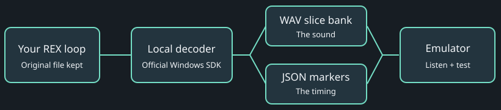

Conversion runs on this computer. Playback runs in the browser.

### What was wrong with the old export?

Its CSV added up slice audio lengths. A slice can have a ringing tail that overlaps the next hit, so those lengths do not tell us when the next hit starts. The corrected converter reads the original REX pulse position (`fPPQPos`) for every slice.

### Why does the WAV look longer than my loop?

The WAV is a bank of intact slices placed end to end. This preserves their tails. The JSON tells the player where to find each slice and when to trigger it. Storage position and musical timing are separate.

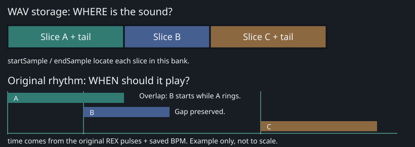

The player reads each slice from the bank, then schedules it at its original musical time.

### Which files should I import manually?

Use `NAME_slices.wav` with `NAME_markers.json`. JSON is recommended: it includes exact sample boundaries, original pulse positions, tempo, time signature and a WAV checksum. The dashboard handoff verifies the checksum. Manual import checks sample count and channel count.

The equivalent CSV uses `Slice,Start,End,Time` in seconds, with a final `Loop,,,duration` row. The old `Slice,Duration,Total` CSV is rejected because it cannot recover the groove. A rendered full-loop preview WAV is a different layout; do not pair it with the slice-bank markers.

### What stays the same, and what changes?

Original slice onsets, slice lengths, mono/stereo channels, sample rate, saved BPM, loop length and time signature are retained. The SDK renders audio to 16-bit PCM WAV; conversion does not resample, downmix or normalize. Values outside the WAV range are clamped. This is not a bit-for-bit copy of the compressed REX data.

Timing uses `seconds = pulse position × 60 ÷ (15360 × BPM)`. The original source BPM is also recorded when the SDK supplies it. Original-timing audition uses the saved REX tempo; Play with FM1 follows the sequencer tempo. Both schedule slices at the emulator's audio rate.

### Can I change tempo or layer it with FM1?

Yes. Press **Play with FM1 · keep pitch**. It starts both from beat one when the sequencer is stopped, or joins the next 4-beat bar when it is already playing. Instrument **PLAY** then stops and restarts both. Set the **FM1 tempo (BPM)** field and press **Set FM1 tempo**, or use the instrument tempo control. Original REX metadata supplies the source BPM; enter it yourself for marker imports that have no BPM.

The loop follows the internal sequencer audio clock, including tempo changes. Its original beat length is retained: a 7/8 loop stays 3.5 quarter-note beats rather than becoming a 4-beat bar. The original groove is not quantized or given the FM1 swing a second time.

**Pitch stays unchanged because each slice plays at its original speed.** Only the slice trigger intervals move. Slower tempos can reveal gaps; faster tempos overlap tails. This is classic REX slice sequencing, not continuous time stretching of sustained audio. Synced loops repeat automatically; the Loop original audition checkbox controls standalone playback. Uncheck Layer with FM1 audio to hear the synced loop alone while keeping the sequencer clock running. **Stop slices** disconnects the loop while FM1 keeps playing; **Play original timing** returns to standalone audition.

### What are the limits?

| Item | Limit |
| --- | --- |
| Input file | 16 MiB |
| Slices | 64 |
| Audio bank | 30 seconds / 1,440,000 source frames |
| Musical loop | 60 seconds |
| Overlapping slice tails | 8 voices |
| Audio format | Mono or stereo, 8–48 kHz |

Unsupported loops produce an explanation rather than silently dropping slices. The standalone converter refuses to overwrite an output folder.

### I cannot hear it. What should I check?

Switch the emulator on, then use the slice panel's **Play original timing** button. Instrument PLAY controls the FM1 sequencer and a synced slice loop. Use Play with FM1 to arm sync again after a standalone audition. Check the slice level and browser/tab audio. Try an individual slice pad first.

### Why was my import rejected?

**Wrong WAV/markers:** use the matching `_slices.wav` and JSON from the same conversion. **Legacy CSV:** reconvert the original REX. **Too many slices or overlapping tails:** this browser player cannot represent that loop yet. **Corrupt or unsupported REX:** check the original in its source application. The converter leaves your original file intact.

### Where does the decoder live?

The local Windows dashboard calls a separate Python helper using Reason Studios' official 64-bit REX SDK. SDK files stay outside the firmware source and emulator bundle. Downloaded conversion bundles include the SDK license and attribution. A remote server would need its own compatible decoder setup; this Windows path has been tested locally.

### Does this put samples into my physical FM1?

No. This import is for browser audition and development. Browser **Save import** stores the WAV and markers in this browser; the instrument SAVE button saves instrument state. Hardware sample transfer, firmware integration and memory budgeting remain separate work.

### What has passed for all 25 sound strips?

The current candidate processes eleven sounds in each 909/808 engine, both 303 parts and the instrument's mono BREAK part with high-pass, low-pass, input boost and a summed-sound sample-peak ceiling. Focused native and actual WASM checks plus independent source review pass. This ceiling has no lookahead or true-peak claim. The separate Marked-WAV preview keeps its own import and playback lane.

The complete fresh mandatory suite and actual local browser GUI acceptance pass. Hosted publication acceptance remains pending, so the all-sound targets are still in progress. Physical draw/audio timing, stack, DMA and device acceptance remain pending. Basic arrangement and saved harmony metadata are already publicly accepted at `e78ee13`; broader insertion/order/loop controls and actual bass-follow, MIDI and pad behavior remain pending.

Local GUI checks cover all 25 selectors, isolated 808 and BREAK edits, undo/redo, saved reload, four arrangement blocks with six synthetic slices synchronized to FM1 at 125 BPM using a 120 BPM source, PLAY stop, live-save rejection and stopped-save acknowledgement. The selected-view checking message clears after settings arrive. At 390px, the document is 375px and editor 343px wide. An older kick-only engine disables the other 24 selectors while keeping its kick controls usable, with no console errors.

### Earlier bass-follow implementation checkpoint

[First-kick browser prerelease](https://github.com/keyboy250/fm1-x0x-acultur8/releases/tag/acultur8-v0.1.0-alpha.kick.1) is published from `1394e5f` after exact hosted source/WASM/checksum verification. Your original alpha and files remain recoverable.

The autonomous implementation goal is active. Lossless fonts and the shared command/save foundation are merged in reviewed PRs #6 and #7 with passing CI and Pages deployment. The opt-in 909 kick is published after host/WASM response, limiter, metering, bypass, local and hosted editor, save/reopen and undo/redo checks.

The integrated target fits flash and memory and passes the original static gates. New active processing costs are measured separately; physical CPU, stack, DMA and device audio acceptance remain pending. All-25 native/actual WASM, independent review, the complete fresh mandatory suite and local browser GUI acceptance pass; hosted publication remains pending. Basic arrangement/harmony metadata are accepted; broader controls and actual bass/MIDI/pad behavior remain development targets.

### Local MIDI accompaniment checkpoint

The private development candidate now implements dedicated-channel chord triads through the real firmware/WASM engine and an opt-in browser MIDI route. Native and actual-worklet regressions pass, including old-project migration, Notes Out undo/redo, original-channel cleanup and pitch-preserving slice timing. The complete required suite passed at source `efe2eca080498ae80d61f662434fca5e42872486e334ebe560892b51ffbb468e`; its 32 packaged file hashes were verified locally. This is development evidence, not a public release.

Independent review confirmed that a late successful route reply can no longer reactivate a disconnected output. A worklet-replacement fix now rejects old requests, preserves original-output cleanup and waits for a fresh engine snapshot before explicit Retry. Focused router/UI tests, independent review and fresh complete suite6 pass at source `fcd814466eabaf5513dbde436e0d0dc39948e7e8ad6bc03d475bdbb5082b8359`. Synthetic browser outputs have exercised triads, Stop, send-failure cleanup, Retry, output switching and narrow layout at 90 BPM. Fresh suite6 browser checks also observed both bass channels, pad and synced original-pitch slices at120/180 BPM; Stop left no owned notes, with352/352 and804/804 Note On/Off events respectively. Quick virtual-key clicks were found to disappear before the firmware scan, leaving intended drums empty; that input fix is in progress. These are partial scene checks, not full drum-and-bass acceptance. Full combined-scene acceptance at 90/120/180 BPM, a recorded 30-minute soak, real receiver delivery and physical-device qualification remain pending.

The latest official external-pad target probe fits at 579,556 / 581,564 image bytes and 97,868 / 98,304 ordinary RAM bytes; pool usage remains 335,712 / 344,064, only 160 bytes above the unchanged reserve. All 15 original static gates pass. These numbers do not prove physical CPU or stack margins. Earlier bass-only and published checkpoints elsewhere on this page remain historical evidence. Public publishing remains held until user sign-off.

CRITICAL PERFORMANCE TARGETS · PLANNED

### Independent lanes. One musical clock.

Every individual 909/808 drum lane, 303 A, 303 B and BREAK will have its own rate and step count. Different lengths at one rate create polymeter; different rates create polyrhythms. These are confirmed development requirements, not accepted firmware functionality yet.

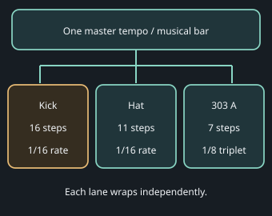

Illustrative target behavior. Arrangement/chord changes keep their musical-bar timing. Supported rates, live phase policy and target resource costs still require implementation and testing.

#### DAW automation while the performance runs

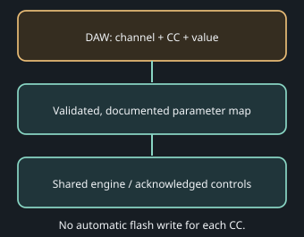

The documented map covers sound/strip/mix/effects, lane timing, generators, pattern fields, arrangement/chords and bass/pad settings. The local candidate has partial implementation and focused actual-WASM tests. Complete parameter coverage, real DAW integration, physical delivery and timing remain open; a received CC does not prove application.

**Local MIDI Undo/Redo candidate:** channel 13, CC 93 for Undo and CC 94 for Redo. Values 0–63 release/rearm; 64–127 request once. Send a release before the next request. Stop playback and finish any active edit first: history requests during a held edit, recording or transport transition are refused without ending the edit. A refused request does not block a following Stop. Native and production-worklet/actual-WASM tests pass; this is not full DAW or device acceptance. Global settings such as tempo still sit outside this undo journal.

The published baseline shares timing inside each drum kit and fixes BREAK to 16 steps/16ths. The new local lane candidate adds independent timing and 64-step BREAK editing; complete live-CC and performance acceptance remains pending. Existing stopped-only settings need live-safe application and original-note cleanup; merely adding a CC number does not make them safe during playback. See critical targets FM1-32/33. [Official MIDI CC reference ↗](https://midi.org/midi-1-0-control-change-messages)

Decoder reference: [Reason Studios REX SDK downloads](https://developer.reasonstudios.com/downloads/other-products). Keep the converted WAV, marker JSON, license and attribution together.

### Local lane checkpoint · 13 October 2026

The new local candidate passes native and actual WebAssembly checks for all 25 sound lanes, 32 patterns, eight rates and 1–64 steps, including 64-step BREAK editing. Its fresh full browser regression suite and all 15 original static firmware gates pass. Firmware uses 581236 of 581564 image bytes and 98048 of 98304 ordinary RAM bytes; the existing pool reserve still has 160 bytes of margin.

Actual browser checks verified mixed hi-hat/bass timing, a length change while playing, save/reopen and BREAK step 64. This is partial performance evidence, not a complete DAW scene or physical-device test. Command-draining work is measured separately; a smaller caller does not prove lower CPU use.

Live CC has a separately tested native candidate and an input-panel prototype. Full lane/CC integration, current browser input, DAW automation and physical timing remain pending. New development stays local under the publication hold. The existing public repository has not yet been made private; this checkpoint is not a hardware release.

FM1-35 · PROPOSED · NOT IMPLEMENTED

### CV/gate sequencing: think of a guitarist’s two hands

A guitarist combines two jobs: **the picking or strumming hand supplies the rhythm**, while **the fretting hand helps choose the pitch through string and fret position**. Our proposed split sequencer separates those jobs into two repeating lanes.

The **gate lane is the picking hand**: a trigger says “play now”, a rest says “do not pick”, and a hold keeps an existing note sounding. The **pitch lane is the fretting hand**: it chooses the note ready for the next trigger. In this first design, changing the pitch lane alone does not start a note.

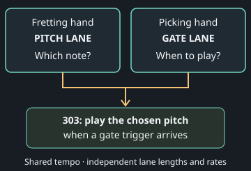

This is a musical analogy, not a literal guitar model. Picking can also choose strings, and hammer-ons or pull-offs can sound notes without a fresh pick. Those techniques need explicit synth retrigger/slide rules.

#### A small example you can read like two hands

Imagine an eight-step picking rhythm over a three-note fretting cycle: **D → F → A**. Both advance on the same tick in this example. The pitch updates first; a trigger then plays that pitch. The repeating pitch lane continues through rests.

| Tick | 1 | 2 | 3 | 4 | 5 | 6 | 7 | 8 |
| --- | --- | --- | --- | --- | --- | --- | --- | --- |
| Pitch / fretting | D | F | A | D | F | A | D | F |
| Gate / picking | Play | Rest | Rest | Play | Rest | Play | Rest | Rest |
| New note heard | D | — | — | D | — | A | — | — |

The dash means **no new trigger**, not necessarily silence: an earlier note’s decay or release can still ring. The next eight-step gate cycle starts while the three-step pitch cycle is at a different position. Their combination repeats after 24 ticks in this simple example. Different rates make the interaction more varied.

#### Does moving the “fretting hand” bend a held note?

Not in the first proposed mode: a pitch change prepares the *next trigger*, while the sounding note keeps its accepted pitch. A later option could let pitch changes retune a held gate, with a defined slide behaviour. Ties, gate duration, accents and slides need explicit rules and tests; the guitar metaphor does not decide them automatically.

#### How would I switch it on?

The proposal is **Classic / Split Gate–Pitch** for 303 A first, keeping 303 B in Classic. Classic keeps the existing combined note/rhythm sequence. Split mode would expose two rows with independent length, rate and playhead. Key/scale locks and chord-following policy would still constrain the chosen notes.

**Status:** feasibility exploration FM1-35. This guide explains the design; it does not claim a working mode in the browser or on the FM1. Internal CV/gate-style sequencing uses note numbers and triggers, not physical analogue voltage outputs. Resource fit, persistence, MIDI mappings, live switching and physical testing remain pending.

### Can I save one sound and put it in another slot?

The planned **sound-variant library** saves a named version of one sound: its timbre controls and processing strip. Load it into a compatible sound slot without replacing your rhythm, notes, lane length/rate, chord progression or other sounds. Pan and effect sends would be preserved by default, with an explicit option to include them.

For example, a 303 A preset can be compatible with 303 B. An 808 kick preset cannot be treated as a 909 snare preset. The paired 808 alternatives share their existing strip. BREAK presets do not include the imported sample bank: keep the matching audio separately.

**Status:** the local library prototype passes format, compatibility, export/import and overwrite-recovery tests using a simulated engine adapter. It is not connected to the emulator yet. Actual-engine capture/load, persistent browser storage, undo and save/reopen checks remain open. Browser library slots and physical FM1 flash slots are separate work. The existing PRESETS encoder still selects patterns.

#### Can a bit crusher run in series with the filters and limiter?

Yes, this is the proposed optional per-sound chain. A crusher reduces amplitude resolution and/or holds samples for a rougher texture. The low-pass filter afterwards can soften the added high frequencies; it cannot undo aliasing. Boost and the enabled limiter follow the effect and its wet/dry mix.

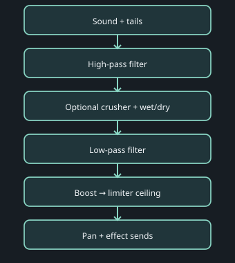

Proposed chain, not an available crusher control. The final ceiling bounds this sound when enabled; several sounds and effect returns can still add together at the master.

**Status:** target FM1-37 is planned. Existing crush effects in some voices do not provide a common crusher on every strip. Bit depth, sample-hold factor, wet/dry, bypass, smooth live changes, MIDI mappings and preset storage need implementation and tests. The combined firmware has narrow measured headroom; this crusher is not yet included or resource-qualified. Browser success alone cannot establish physical-device support.

### How could several FM1s play a one-to-two-hour live set?

**Planned: FM1-39 and FM1-40.** Choose one clock leader and explicitly route its timing to the followers. MIDI clock supplies the pulse; Start, Continue and Stop control transport. Matching tempo alone does not prove matching bar position, and clock does not send chord changes or our scenes.

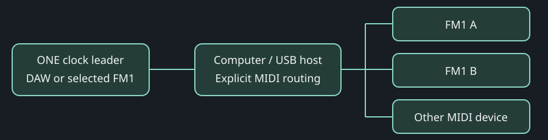

A regular USB hub expands the host's connections; it cannot route MIDI on its own. Instrument audio goes separately to a mixer or interface. Physical connections still require equipment-specific checks.

Direct FM1-to-FM1 USB daisy chaining is not supported by the current device-mode firmware. Use a computer with separate device connections, or a verified standalone USB-MIDI host/router. The current FM1 TRS implementation is MIDI input; do not assume an output or Thru jack.

The proposed Performance Clock page will show Lead / Follow / Standalone, source and destinations, BPM, bar/beat, waiting or lost-clock status, and an explicit recovery policy. Current code automatically returns to internal timing after half a second without external clocks; controlled live recovery and single-source ownership are new work.

For long sets, prepare reusable musical sections and a saved set list. Queue the next scene for a shared bar boundary, with confirmed versus pending feedback. The existing 192-block song model permits up to eight repetitions per block: about 49 minutes at 125 BPM in 4/4 at maximum repeats, not an unlimited two-hour timeline. Longer saved sets and gap-free scene/project changes need implementation and acceptance; manually repeating or cueing patterns is different from automated long-set support.

Two devices could alternate current and next material while their audio is mixed, but seamless preparation and multi-device cues are not yet qualified. Required checks include dropped/duplicate clock, Stop and reconnect, sustained-note cleanup, foreground/background behaviour, full-scene listening and a real two-hour soak. GitHub source updates are authorised; a new Pages release and hardware flashing remain held for separate sign-off.

**Development status:** reviewed Stop/transport and USB session fixes pass native regressions. An earlier combined target exceeded firmware space by184bytes. The newer isolated full clock-role candidate now passes all15 original static gates at581348image/98292ordinaryRAM/335720pool bytes, with216image and12RAM bytes spare. Independent initialization/deadline/cost review and actualWASM qualification remain pending; it is not integrated. No Performance Clock page or live multi-device set is accepted yet.

Protocol references: [MIDI Association USB topology](https://midi.org/basic-of-usb) and [clock and transport messages](https://midi.org/about-midi-part-3midi-messages).

### How will other developers make compatible modules?

Our [developer compatibility and audit guide](https://github.com/keyboy250/fm1-x0x-acultur8/blob/acultur8/main/docs/COMPATIBILITY_GUIDE.md) defines requirements for human developers, Codex and similar coding agents. Contributions must document versions, interfaces, parameter and MIDI meanings, save migrations, licences and resource budgets.

Independent review checks evidence against an exact commit. Native, browser, firmware, receiver and physical-device results are recorded separately; untested gates remain open. These are compiled source modules, not runtime plugins. Guide version 0.1 is a development contract; automated manifest validation and third-party compatibility fixtures are still planned under FM1-41.

### Could several devices express one chord together?

Our distant-future Paraphonix proposal would distribute chord tones across compatible devices, following one progression, key and scale. For example, three melodic voices could play D, F and A together while a global voice budget limits note density. Range locks, voice leading and supported expression would shape the result.

FM1-43 is planned only. Receiver capabilities, sustained-note cleanup and release tails must be tested. A voice cap does not guarantee safe audio levels; mixing, metering and headroom remain separate. Devices do not automatically share a physical filter or envelope, and extra onboard voices or per-note expression support are not assumed.

### Can MIDI control the imported loop?

The browser candidate maps all thirteen slice controls to channel 13, CC 80–92: level, repeat, layering, source tempo, slice audition, play, stop, sync, import, demo, save, reopen and marker export. Enable the selected CC input explicitly. The physical firmware's USB/TRS slice bindings remain unsupported.

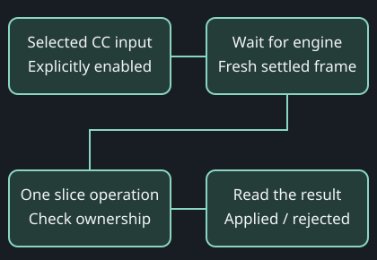

An input receipt confirms queued MIDI; a separate operation result confirms what happened.

Select matching WAV and markers before sending Import; MIDI opens no file chooser. Import, demo and reopen require stopped, unowned playback. Save finishes only when the browser database transaction commits; a failed save retains the prior saved import. CC Export prepares marker JSON, while the manual Export control requests a download. Trigger actions rearm below 64 and fire at 64 or above.

Repeat changes preserve the current slice cursor and tails until the original loop boundary. Source-tempo changes during sync rearm at the next four-quarter bar and stop existing slice tails; this is not seamless tempo morphing. Local native/worklet tests and the genuine browser database harness pass all thirteen paths. Fresh combined-main software checks pass; real AudioContext, DAW/device, download delivery and full performance acceptance remain open.

### How do MIDI editing actions avoid accidental changes?

The local integration candidate adds eleven native actions and explicit destination, arm and cancel controls. Select the pattern, part, destination and block explicitly. Destructive edits require an action-specific arm and stopped, validated ownership; they do not silently retarget the selected front-panel page. Continuous musical controls retain their separate live-automation path.

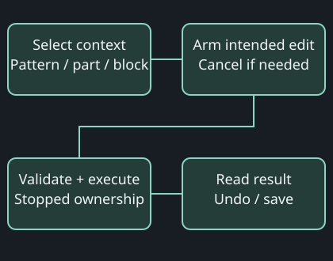

Queue acceptance is not proof that an edit applied. Read the action result; rejection keeps the project intact.

Save, clear/copy, motion clearing, song-row insert/delete, reset and performance actions have different prerequisites. Reset requires a verified clean saved checkpoint and preserves it for recovery; it is not an ordinary undoable edit. Benchmark tests verify completion and Stop restoration. Physical flash failure and power-loss recovery are still unqualified.

Status: independent code review, the existing nine-check suite and all fifteen original firmware gates pass in isolation. Action-specific production-worklet/WASM checks pass and are now mandatory; the fresh integration suite passes all nine checks. Image usage is 581492 of 581564 bytes; ordinary RAM is 98272 of 98304 bytes. The thirteen browser slice controls now have the local candidate described above; physical slice bindings and complete DAW/device acceptance remain open. This is not a new Pages or hardware release.

**Firmware space:** reviewed lossless table encoding preserves every original sound value and recovers 1008 bytes in a complete target build. The locally integrated image is 580484 bytes; RAM is unchanged. Both resource suites pass all nine required checks; PR19 is merged after GitHub CI passed. Pages remains held. Physical timing and stack headroom remain unqualified.

### Can I sweep lane speed without jumping into triplets?

The per-sound **rate-family selector** offers **Straight only**, **Straight + dotted (no triplets)**, **Straight + triplets**, and **All**. A family-aware MIDI sweep moves from slow to fast through only allowed choices. Existing raw CC meanings remain unchanged.

**1/2** lasts two quarter-note beats; **1/8** lasts half a beat; **1/8D** (dotted eighth) lasts three quarters of a beat; **1/8T** (eighth-note triplet) lasts one third of a beat. Dotted multiplies duration by 1.5; triplet multiplies it by two thirds.

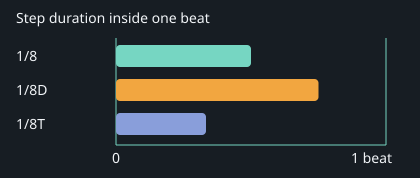

Longer duration means slower steps. Filtering triplets prevents unwanted family changes; rate changes still alter the relationship between lanes.

**Status: implemented in the reviewed local candidate.** All21 choices use compatible versioned storage and rational engine timing. Changes finish the current interval and apply at the next sound step, with an optional next-bar policy. See the expanded-rate controls below. Physical MIDI/device qualification remains pending; Pages held.

### Why can I only change the whole drum kit length?

An older dashboard or published emulator may still expose the grouped kit controls. In the current tested local candidate, switch on, stop playback, find **Sound lanes**, and choose **Initialize independent lanes**. Select the pattern and individual sound, then change **Length (steps)** from1 to64. Leave the number field to commit; read the acknowledged result. Grouped mode uses each kit BD clock; choose independent mode for individual timing.

Fresh packaged-browser checks preserved a seven-step909 closed hat and thirteen-step808 kick through sound selection, Save project and reload. These are focused GUI/persistence checks; full live-scene and physical acceptance remain open. The separate preview origin has separate browser saves.

Real muted AudioContext tests also pass all13 slice MIDI controls, with measured full/half/zero gain and explicit Stop cleanup. This verifies rendering, not human listening or the reported clicking. A Windows generic Python server can serve MJS as plain text and prevent startup; the verified local alpha helper supplies the proper module MIME types.

### How do I import a REX loop into this preview?

The standalone emulator accepts a **slice-bank WAV plus matching marker JSON**. Raw REX decoding runs in the separate local Windows dashboard converter; the static browser package does not include that decoder.

- In the local development dashboard, open **REX converter** and select your .rx2, .rex or .rcy file.

- Choose **Convert loop**. Download the matching `_slices.wav` and `_markers.json` from that conversion.

- Return to this preview. Choose the WAV under **WAV audio** and JSON under **Exact slice markers**, then choose **Import WAV + markers**.

- Audition original timing, or use **Play with FM1 · keep pitch** to sequence the retained slices at the FM1 tempo. Save import in browser stores them for this preview origin.

**REX loop → local decoder → slice-bank WAV + timing JSON → browser audition.** Conversion preserves original cuts and musical trigger positions; WAV storage position and trigger time are different. Your original REX stays unchanged. An older dashboard converter's Open in emulator button may open its older engine; use the downloaded pair when testing a newer separate preview.

If the converter is unavailable on this machine, import an already converted matching pair. Restricted SDK files and private loops are excluded from the public package. This workflow does not transfer samples into physical FM1 flash.

### What happens after the reboot?

Development is paused at your request. Restart the checked local preview with its existing port so its browser saves remain available; do not use Factory reset. The latest checked package is `build/site-slice-qualified-1b66770`, served with `python tools/serve_alpha.py --site build/site-slice-qualified-1b66770 --port 8133` from the integration workspace. Earlier preview ports have separate saves.

The next working day prioritizes preview recovery, exact-head source PR20 checks, the clock transport race correction and reproducible click diagnosis. The following day prioritizes lossless rate migration, rational timing and family-safe MIDI sweeps, subject to resource and review gates. Expanded rates are not available in the current instrument yet.

The clock candidate fits static limits, but independent review found a late Start/Continue race; it is not approved for integration. Browser Pages deployment, real DAW/receiver tests and physical-device qualification remain pending. Source PR20 is open; local tests pass, but remote CI was still running when paused. No merge or publication while paused.

### Current local clock checkpoint

Clock repair independently reviewed PASS and integrated locally from commit12d32d695387ef83601ec3c4cc9cddce08f3a0cd. Fresh complete mandatory suite9/9 PASS; all41 frozen artifact hashes verified; original15 target gates and caller/helper aggregate PASS. Production guard preserves exact ICFG state; generation/retirement publication, reserved Start/Continue and MIDI replacement ownership are covered. Target image581444/581564, RAM98292/98304, pool335720/344064 (120image,12RAM and152above8192reserve spare). Real muted AudioContext clock/role/source-loss checks PASS using exact production worklet/WASM; no MIDI permission or physical receiver claimed. Physical IRQ timing, stack, DAW/receiver and soak remain pending. Expanded rates remain unwired. Pages held; no remote push or clock merge. Existing8133 preview and browser storage preserved; this local integration does not reload that frozen PR20 preview. See docs/CLOCK_REVIEWED_INTEGRATION.md. This supersedes the older paused/unintegrated clock status.

Per-sound lengths already support 1–64 in Sound lanes. Expanded straight/dotted/triplet families remain future work; the current eight rates are unchanged.

### Expanded divisions and family-safe rate sweeps

In Sound lanes, initialize independent lanes while stopped, then choose **Enable expanded rates**. Each of the25 sounds has21 divisions: straight, dotted and triplet forms of1/1,1/2,1/4,1/8,1/16,1/32 and1/64. Dotted lasts1½ times the straight duration; triplet lasts⅔. Length remains a separate1–64 step setting.

Choose **Straight only**, **Straight + dotted**, **Straight + triplet** or **All**. This sound’s sweep policy is shared across patterns. A family change keeps allowed rates and moves excluded rates to the nearest allowed duration; exact ties choose the slower one. The saved rate and the effective playing rate are shown separately while a change is pending.

**CC0 →**1/1→1/2→1/4→1/8→1/16→1/32→1/64**← CC127**

A sweep uses stable slow-to-fast bins and0–2 CC units of hysteresis. Straight-only and Straight+dotted sweeps cannot select triplets. Repeating a value within its bin does not change the rate or consume the audio control queue.

| Control | CC | Parameter |
| --- | --- | --- |
| Enable expanded rates, stopped | 111 | 1135 |
| Exact division ID0–20 | 112 | 1136 |
| Family0–3 | 113 | 1137 |
| Step/bar boundary0–1 | 114 | 1138 |
| Hysteresis0–2 | 115 | 1139 |
| Family-safe sweep ABI1 | 116 | 1140 |

Use the existing explicit pattern/sound selectors and selector commit first. CC values for enum fields use the registry’s normal scaling; parameter values are exact through the existing exact-value transaction. Legacy lane.rate1129/channel13 CC105 retains its eight original meanings. Exact-rate selection is separate from the family-safe sweep.

Live changes preserve the interval already in flight and adopt at the next sound step, or the next sound step after the next bar. Stop before Undo, Redo or Save. Expanded saves use format6; older firmware refuses them. Native SEQ includes an appended RATE FAMILY page; BREAK also has a DIVISION page when expanded.

Clock interpolation uses fractional MIDI-pulse durations. Ambiguous queued-clock timing or an out-of-domain period freezes playback; clocks alone do not restart it. Physical MIDI receiver, timing, stack, listening and soak acceptance remain separate. Pages remains held.

### Can each sound remember its own filter and limiter defaults?

**Newer hardware evidence:** see [303 controls and power-cycle recall](#guide-fm1-hardware-20261017). Older dated qualification paragraphs below remain historical checkpoints.

**In development: per-sound defaults for the browser and FM1.** The isolated candidate adds **Save as sound default** and **Apply saved default** to each selected sound strip. The reviewed local preview, build25641496, does not yet include these controls.

Choose a sound, set its high-pass and low-pass cutoffs, boost, limiter ceiling and release, and choose which stages are enabled. Stop playback, then save that sound’s default. BD and CHH have separate defaults, as do all25 sounds.

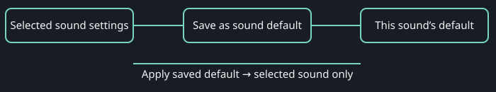

Defaults are reusable starting settings. Save project keeps the current strip settings with that project.

Applying a saved default changes only the selected sound. Existing projects are not overwritten automatically. The candidate groups recall into one Undo step and preserves the saved release time when another control is edited. Release is editable from10 to250ms; the limiter ceiling is a sample-peak ceiling.

**Local qualification in progress, 16 October 2026.** Focused tests now cover all25 sounds, explicit Save/Apply, release persistence, selected-only recall, Undo/Redo, damaged or oversized banks, and storage failure/retry feedback. An isolated real browser confirms separate kick/hat defaults survive reload and never automatically replace project settings. The latest packed samples match the original PCM exactly with sanitizer checks, and the target passes the original static limits. The complete mandatory regression suite passes all9 groups, including31 host scenarios and packaged parser/WASM checks. Defaults remain isolated pending reviewed integration. Real-browser quota exhaustion and physical FM1 flash, power-loss, menu, listening, timing and stack checks remain separate. Pages publication stays held.

### Can my DAW groove the arpeggiator with MIDI trigger notes?

**Requested feature, not implemented yet (FM1-46).** An external MIDI gate mode will let a DAW note pulse advance the arpeggiator one position. Choose an input source, MIDI channel and trigger key, such as the key your DAW labels **C-2**. The UI should also show its numeric MIDI note, because octave labels differ between DAWs.

Each matching Note On with velocity above zero advances once. The gaps between the DAW’s pulses supply the groove, replacing automatic division timing such as1/16 in this mode. With no pulse, there is no next step. Note Off, velocity-zero Note On and other channels or keys do not advance it. Internal straight, dotted and triplet timing remains available as a separate mode.

Planned example: send five unevenly spaced C-2 pulses on the chosen channel and get five advances at those pulse times. Note duration and Stop/disconnect cleanup must be specified and tested with the actual engine. This is a MIDI-note trigger proposal; the existing CC-only browser input does not already provide it. Native/WASM and real DAW/FM1 timing acceptance remain pending. Pages stays held.

### Where are the 303 filters, limiter and saved defaults?

**Hardware check, 17 October 2026:** both 303 A and 303 B expose STRIP FILTERS, STRIP LIMITER and STRIP DEFAULTS. ALGORITHM selects the part; SELECT moves through its sound pages. STRIP FILTERS uses KNOB1/2 for HP/LP cutoffs and KNOB3/4 for their enables. Overall STRIP enable is separate, on STRIP DEFAULTS.

With playback stopped, STRIP DEFAULTS uses **KNOB2 clockwise: SAVE DEFAULT** and **KNOB3 clockwise: APPLY DEFAULT**. These affect the selected sound's filter, limiter and enable settings. Do not use SAVE while testing recall: that replaces the reference.

**Verified on this FM1:** 303 B HP returned from100Hz to146Hz before and after a normal power cycle, with a fresh deliberate change to100Hz after restart. The setup saved LP10240Hz and individual filters enabled; their post-cycle readback, limiter fields, overall STRIP enable and other sounds remain unverified. This is a narrow persistence pass, not all25-sound or power-loss acceptance.

**Known issue FM1-49:** post-cycle Apply displayed a blank message, although the HP readback proved recall succeeded. A blank message alone does not establish success or failure.

**Requested policy FM1-48:** normal HP150Hz; chosen drums may be lower but never below55Hz; LP no higher than11kHz. This policy is not yet implemented globally.146Hz is below a strict150Hz standard; precise values, drum exceptions and range/default behavior remain to be resolved.

The boot-animation candidate is installed locally; explicit appearance/hold/skip acceptance remains pending. Device photos are catalogued privately for future FAQ illustrations. Pages publication stays held.
