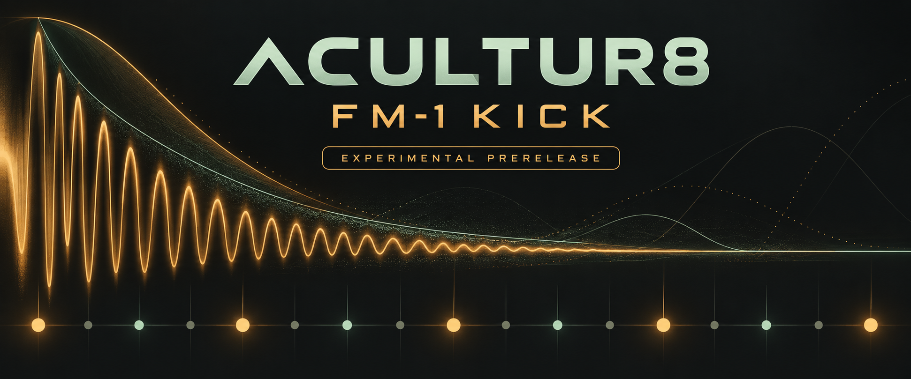

# Acultur8 FM-1 kick prerelease documentation

Version **0.1.60-stoppedtrace / FM-1_9000160**. Read the known limits before updating.

- [Full FAQ — current prerelease questions plus the complete illustrated earlier FAQ](FAQ.md)
- [Updated comparative features — pinned .32 versus .60](FEATURE_COMPARISON.md)
- [Complete 803-row MIDI/CC map](CC_MIDI_MAP.md): [searchable HTML](CC_MIDI_MAP.html), [CSV](CC_MIDI_MAP.csv), [JSON](CC_MIDI_MAP.json)
- [Five task-based tutorials](tutorials/README.md)
- [All starter preset native values](STARTER_NATIVE_CONTROL_REFERENCE.txt)
- [Install and recovery](../INSTALL_RECOVERY.txt)
- [Current release scope and test summary](../RELEASE_CURRENT.txt)
- [Open qualification boundaries](../FINAL_ACCEPTANCE.txt)

The linked pages are versioned source documents. Publishing this prerelease does not update GitHub Pages or send social posts. Historical FAQ planning labels are preserved as history; current prerelease status is stated at the top. Artwork is illustrative, not a measured waveform.
