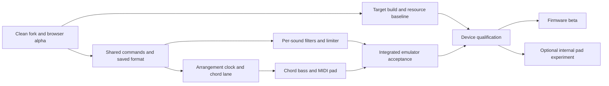

# Acultur8 X0X: implementation and GitHub variant plan

Execution checkpoint: 13 October 2026 UTC. The user authorized an active implementation goal, dependency setup, independent agents, reviewed GitHub merges and browser-alpha publication. The public fork and integration branch now exist; browser alpha.1 is published; device qualification remains pending.

## Current expedited execution plan — 13 October 2026

This checkpoint supersedes all earlier priority orders, delivery estimates, proposed PR numbering and pre-publication status snapshots. Historical sections below are retained for provenance and are not the current execution queue or forecast. The public variant already exists at https://github.com/keyboy250/fm1-x0x-acultur8 with integration branch `acultur8/main`. Reviewed PRs #1–#8 are merged. Browser alpha.1 remains the known-good tag; the current Pages site additionally includes the About page linked to Acultur8.com and Traxsource. About publication passed local checks, independent review, merged CI and hosted verification at commit `84d924660522f275baff6c3cd1741479bbe898b1`.

Lossless fonts and the shared command/save/DSP foundation are merged after review and required CI. The audible kick and its browser controls passed local and hosted acceptance. Standing authorization covers ordinary implementation, official free dependencies, independent agents, tested/reviewed merges and Pages releases. The persistent implementation goal is active under the user's renewed authorization. Website publication to Acultur8.com is a separate deployment task awaiting its hosting connection.

### Ranked next ten targets

| Rank | Development targets | Next deliverable and acceptance |
| --- | --- | --- |
| 1 | FM1-06 | Merged lossless fonts save 18,368 image bytes; regeneration and exact glyph/display/audio checks pass. Current integrated kick target image is 570,020 bytes, general RAM 97,636 and pool 334,612; original static gates pass. Record device draw/stack timing as pending. |
| 2 | FM1-04 | Record synthetic factory/dense-pattern bypass audio, output/clipping and reproducible host/WASM costs. Create one resource ledger for the full intended configuration before allocating every processor/timeline. |
| 3 | FM1-05, FM1-07 | Close shared-command/versioned-save review; test actual WASM replies, applied queue tickets, invalid commands, backpressure, one-gesture undo, legacy defaults, new save/reopen, corruption/capacity rejection and interrupted-save behavior. Measure integrated target image/RAM/pool. |
| 4 | FM1-27, first slice of FM1-03 | Complete one 909 kick from engine to browser controls: HPF, LPF, boost, ceiling, bypass and gain-reduction feedback. Verify response, summed tails/ceiling, smooth edits, save/reopen and undo against bypass references. |
| 5 | FM1-11, FM1-12 | Expand the accepted strip to 25 sounds/parts with linked stereo and proper core ownership. Verify both 808 paths, summed same-sound voices/tails, pan/sends and cumulative resources. |
| 6 | FM1-13 | Reuse existing patterns/song entries for paged arrangement blocks. Add explicit duration and separate editing/playing/queued states; verify quantized transitions, odd-length parts, clock and persistence. |
| 7 | FM1-14 | Add key/parent-scale and degree I–VII per block using one shared triad resolver. Test all supported seven-note modes and saved C–Am–F–G. Pentatonic requires a seven-note parent or disables seven-degree selection. |
| 8 | FM1-15 | Both bass generators and mutation follow the current chord. Preserve rhythm, accents/slides and legacy absolute notes; test chord/root modes, octave bounds, ties, transpose, block changes and actual played/MIDI note agreement. |
| 9 | FM1-16 | External MIDI pad triads first, configurable dedicated channel and event monitor. Track actual held notes and test cleanup on chord/channel/project/transport changes and disconnect. Real receiver acceptance remains pending until performed. |
| 10 | FM1-28 | Accept the synthetic four-block musical scene with both basses, drums, synced slices and MIDI events at 90/120/180 BPM, edit/queue independence, save/reopen and a recorded 30-minute browser soak. Publish the tested arrangement alpha. |

### Architecture and memory decisions

Use the shared C engine for synthesis, processing, sequence/chord resolution and persisted intent. The dashboard presents acknowledged state; it must distinguish desired, queued/applied and audible-processing capabilities. Browser-only controls do not establish physical USB/device editing support. Keep the existing slice transport/import saves separate from instrument project saves.

Reuse the existing 32 patterns, 64-step patterns, 16-step pages and 192 song entries. Add compact block duration/chord intent to that model rather than another sequencer. Derive triad pitches from key/mode/degree instead of saving redundant note lists. Size the complete proposed extension, runtime state, queue overhead, undo shadow, staging and stack before freezing the next schema. Preserve explicit migrations; never silently truncate unknown future data.

Baseline general RAM has only 1,088 bytes spare; the pool has 1,548 bytes beyond its required 8 KiB reserve. Font compression frees flash, not RAM. Standalone DSP uses 64 bytes of runtime state per strip, plus configuration storage; 25 runtime states alone cost 1,600 bytes before the save/undo and harmony additions. These quantities are different memory regions and cannot simply be added to one generic free-memory number. Measure actual linker/pool placement after each integrated candidate. Reduce duplicate/cache storage and pack bounded intent where needed; do not weaken established limits or reserve gates to make a build pass. Any feature that cannot fit remains explicitly browser-experimental while target integration is redesigned.

The first sound chain is summed sound/tails → nonresonant HPF → LPF → input boost → stereo-linked sample-peak ceiling → pan/effect sends. New processing defaults to exact bypass. Existing master protection remains necessary when sounds and effect returns combine. No first-release claim of true-peak limiting, IK algorithm equivalence or continuous pitch-preserving stretch of sustained slices.

### Parallel work and review sequence

After the command/save contract is accepted, use three bounded implementation lanes: sound integration/resource work; arrangement/harmony; dashboard controls and browser acceptance. Keep one owner for shared schema/engine files and freeze reviewed contracts before dependent branches move. A separate reviewer checks each candidate and required CI runs against its exact commit. Independent work continues when hardware, a receiver or optional decoder licensing blocks another target.

| Branch | Reviewable scope | Dependency |
| --- | --- | --- |
| `perf/lossless-fonts` | Font packing, regeneration and parity/resource evidence | Existing alpha |
| `core/variant-project-format` | Bounded commands/snapshots, acknowledged browser bridge, versioned saves and undo | Existing alpha; integrated resource check after fonts |
| `audio/kick-strip` | One complete audible/editable/saved kick strip | Foundation and bypass baseline |
| `audio/all-sound-strips` | All 25 strips, both 808 paths, stereo/core ownership and resource ledger | Accepted kick |
| `seq/arrangement-blocks` | Duration plus editing/playing/queued block states and saves | Foundation |
| `harmony/progression` | Seven-degree lane and shared triad resolver | Arrangement |
| `harmony/bass-follow` | Both generators/mutation/playback follow chords | Progression |
| `midi/pad-accompaniment` | Dedicated chord events and held-note cleanup | Progression |
| `release/musical-alpha` | Synthetic scene, soak, hosted acceptance and docs | Sound and musical features |

These are proposed branch scopes; GitHub assigns actual PR numbers. Avoid unrelated upstream refreshes or a broad UI redesign in these branches.

### Expedited delivery forecast

Allow roughly 1–2 focused engineering days to integrate/review fonts and the shared foundation; 1–2 more for the complete kick prototype; 2–3 for all-sound integration while arrangement proceeds; and 3–5 for progression, bass/MIDI and combined browser acceptance. With independent lanes, a sound-controls alpha is a reasonable 4–7-day planning window and a musical browser alpha 8–12 days from active implementation. These are forecasts, not completed work or deadlines. Memory redesign or a failed musical/soak check extends the estimate. Device qualification has no defensible date until hardware testing is possible.

Publish an early kick prototype prerelease only after its complete vertical acceptance. Promote proposed `acultur8-v0.1.0-alpha.2` after all-sound browser acceptance, then `alpha.3` after the complete musical scene. Each release identifies exact source, builder and artifact hashes, supported features, persistence impact and remaining device limits. Keep alpha.1 and prior working artifacts recoverable. Require hosted subpath/link/import checks after Pages deployment, not only a green build.

### Completion and deferred work

Every merge needs focused feature tests, the required host/WASM/dashboard/publication suite, independent review, clean publication boundaries and recovery evidence. Preserve existing accepted scope; status changes require real acceptance results. Keep targets/history/FAQ synchronized at each milestone. No private loops, account files, decoder SDK or unresolved-license converter code enters a public artifact.

Hardware recovery, flashing, real CPU deadlines, audio/USB/MIDI/external-clock behavior, save/reboot and prolonged device playback remain explicit pending checks under FM1-09/FM1-10 and related targets. An internal synthesized pad, hardware sample transfer, standalone decoder distribution, richer chords/inversions and external-clock slice synchronization remain later work. External MIDI accompaniment and synthetic test loops let browser development continue without those dependencies.

## Recommended delivery

Extend the published browser alpha with the new musical features in small, tested increments. Develop the DSP, sequencer and harmony in shared C code so the emulator exercises the same implementation intended for the FM1. Qualify the physical firmware separately once its toolchain, resource measurements and recovery path work.

Variant: **Acultur8 X0X**, an experimental variant of Charles Vestal's X0X for the M-VAVE FM-1. Repository: [keyboy250/fm1-x0x-acultur8](https://github.com/keyboy250/fm1-x0x-acultur8), forked from `charlesvestal/fm1-x0x`. Integration branch: `acultur8/main`. Merged [PR #1](https://github.com/keyboy250/fm1-x0x-acultur8/pull/1) contains the initial verified source delta; PRs #1–#3 passed relevant checks and independent review before merging.

## Current execution evidence

- Source provenance: 230 of 230 upstream baseline files match the supplied archive; original files remain preserved. FM1-01 is accepted.
- Release work: the public fork and `acultur8/main` exist; reviewed PRs #1–#3 are merged; alpha.1 identifies exact commit `0487778bf76915c2312644791d92d30378f4ecb5`.
- Portable setup: eleven disposable-clone dashboard checks and three browser packager checks passed. Committed clean-clone launch without an SDK passed; the browser alpha is published.
- Firmware resource baseline: image 581,444 / 581,564 bytes; general RAM 97,216 / 98,304 bytes; pool 334,324 / 344,064 bytes. This leaves only 120 image bytes, 1,088 RAM bytes and 1,548 pool bytes beyond the required 8 KiB reserve. New features require measured size reductions before device qualification. Physical processor timing is still pending.
- Restricted decoder SDK, converter source with unresolved distribution permission, private loops, imports and credentials stay outside the public checkout/package.

## Historical pre-publication capability snapshot

This earlier snapshot is superseded by the current execution plan and accepted alpha checkpoint above.

| Capability | Current evidence | Remaining release work |
| --- | --- | --- |
| Local editing dashboard, backups, source comparison, emulator rebuild | Implemented locally | Remove workspace layout assumptions; clean-install acceptance |
| Browser firmware emulator | Recorded native/WASM audio comparison and sample-slot checks | Reproducible CI build and static hosting package |
| WAV plus exact slice markers | Parser, native/WASM and browser import/save/reopen evidence | Synthetic public example; user-library acceptance |
| REX original timing conversion | Seven official SDK fixtures checked; Windows dashboard handoff checked | Separate converter distribution decision; portable local configuration |
| REX pitch-preserving tempo sync | Recorded 90/120/180 BPM, unchanged PCM, bar join, live tempo and shared transport tests | Public browser smoke checks; external-clock scope remains separate |
| Illustrated FAQ | Served/standalone styling, readable diagrams and narrow layout checked | Published-path links and release-specific wording |
| Pattern paging and song playback | Existing 32 patterns, 64 steps, 16-step pages, 192 song entries and 1–8 repeats | Clear arrangement block editing and explicit musical duration |
| Per-sound filters/limiter, chord lane, chord bass and pad | Requirements captured in `FM1_MOD_SPEC.md` | Implementation and acceptance |

Existing accepted browser rows FM1-18 through FM1-21 remain complete within their recorded scope. This plan adds release gates; it does not revoke those results. The recorded sync build's source and WASM hashes were rechecked during this planning pass and still match. The audio/browser test suites were not rerun for this documentation-only change.

### Source provenance recovered

- Firmware archive comment identifies upstream commit `47f8e4c4ad602591b81c21bc5480db7a94f6d6af`; GitHub confirms that commit exists and describes X0X 1.0.6 documentation.
- `fm1-x0x-main.zip` SHA-256: `d7c95a8d716a086bb6466d1023f55beb548dd5f565961f5160c512b12af38d47`.
- The original extracted working firmware is preserved. A separate Git checkout matches all 230 extracted baseline files exactly before import. The imported delta contains five modified files and eleven added files, with no removals.
- Modified: `firmware/src/app/engine.c`, `firmware/src/seq/sequencer.c`, `web/emu/index.html`, `web/emu/worklet.js`, `web/emu/x0x_web.c`. Additions are the marked-slice player, import/panel code and six tests.
- Dashboard and converter changes live outside that firmware tree and need explicit packaging.
- Converter archive comment: `c720804d6a56730ccbc3042fd4338e3db3b5af24`; archive SHA-256: `e2c5c814f6dd55ffcdd82ea406270ecf2b9ca7468d3401748f00e3766c20263d`. This identifies the supplied archive; matching it against upstream remains a converter publication task.

## Historical initial target order (superseded)

Order is the default implementation sequence. Each row becomes a GitHub issue with dependencies, a demonstrable result and a test record.

| Priority | Target | Implementation | Acceptance before merging |
| --- | --- | --- | --- |
| 1 | Publishable GitHub/browser alpha | Preserve upstream history, import the verified delta, package dashboard and static emulator, keep runtime data private | A fresh clone builds and runs; deployed demo imports a synthetic WAV/JSON pair and syncs to FM1; release archive contains only allowed files |
| 2 | Reproducible builds and performance baseline | Pin build inputs; automate host/WASM checks; establish actual FM1 build; repair inherited target-cost checks | CI runs required checks without silent skips; baseline RAM/pool/image and target timing reports exist before DSP expansion |
| 3 | Shared controls and compatible saves | Define stable parameter IDs, audio-thread commands, project extension format and migrations | Old projects sound unchanged with features off; new settings survive save/reopen/undo; corrupt/newer formats fail safely; storage budgets pass |
| 4 | Independent HPF/LPF | One reusable processor, first on 909 kick, then all 25 sound strips | Individual control, measured cutoff response, smooth automation, silent/bypass stability and acceptable cumulative cost |
| 5 | Boost and ceiling limiter | Add input gain and linked output ceiling to each strip; retain master protection | Test impulses, sustained tones and dense patterns; measured ceiling, bounded gain reduction, aligned timing and clean bypass |
| 6 | Paged arrangement and block transitions | Extend existing song/pattern model; distinguish edit page, playing block and queued block | Blocks play the intended patterns/duration; editing does not jump playback; wrap, repeats, unequal part lengths and transport behave deterministically |
| 7 | Key/scale chord progression | One chord per block initially; degrees I–VII derived from a seven-note scale | Correct notes/qualities in every supported key/scale; exact boundaries; saved progression and active-chord display agree |
| 8 | Chord-following bass | Both 303 generators and mutation use shared harmonic intent; resolve final notes at playback | Strict mode emits only current chord tones, including after transpose/mutation; accents/slides/rhythm persist; MIDI agrees with audio |
| 9 | Pad accompaniment | Dedicated external MIDI chord lane first; simple internal three-voice prototype behind a feature switch | Correct note-off/channel/transport behavior; browser monitor proves events; real MIDI recipient proves sound; internal version requires measured headroom |
| 10 | Integrated device candidate | Run complete arrangement + sound + harmony workload; establish recovery and hardware acceptance; assess sample-slot limits separately | Target budgets, prolonged audio/MIDI/control/save tests and recovery proof pass before an installable public beta is promoted |

## Historical initial milestone estimates (superseded)

These are planning ranges in focused engineering days, not delivery dates. Re-estimate after the first sound-processing prototype. Hardware access, toolchain availability and distribution permissions can change elapsed time.

| Milestone | Scope | Indicative effort | Deliverable |
| --- | --- | --- | --- |
| A — Browser alpha | Targets 1 and browser portion of 2; complete current REX/FAQ packaging | 2–3 days | Proposed tag `acultur8-v0.1.0-alpha.1`, source, playable demo, local dashboard setup |
| B — Sound controls | Shared command/save foundations, one complete sound strip, then all strips | 3–5 days | `alpha.2`: per-sound filters, boost/ceiling and meters in emulator |
| C — Musical arrangement | Block clock, progression, both chord-following bass parts, MIDI pad | 5–8 days | `alpha.3`: end-to-end song with chord changes and accompaniment events |
| D — Device candidate | Target build and resource work begun during A; integration, migration and hardware acceptance | 3–5 days plus device/SDK dependencies | Firmware release candidate; public beta only after device acceptance |
| Optional follow-up | Minimal internal pad; hardware REX slice transfer; richer chords/time-stretch | Estimate from measurements | Separate feature releases; do not hold A–C for these |

The core route is approximately 13–21 focused engineering days, with a useful first public demo after the initial 2–3-day milestone if the repository and publication checks are resolved. Hardware qualification is conditional, not a promised deadline.

The sound and harmony paths can proceed independently after their shared interfaces are defined. Integration and tests stay incremental; this diagram does not assume additional agents or developers are available.

## Historical initial execution strategy (superseded)

The first useful delivery is the existing emulator and slice workflow running from a clean public checkout. The second is one audible, editable and persistent sound strip. Avoid making the entire firmware feature set a prerequisite for either delivery.

### First three engineering days

This is an execution order within milestone A, not a calendar promise. Carry an unfinished acceptance gate forward instead of publishing an unverified build to meet the estimate.

| Work window | Concrete output | Exit check |
| --- | --- | --- |
| Day 1 | Separate variant checkout; verified baseline/import diff; public-file allowlist; documented source and dependency versions | Every changed file has a known origin; original working source and user imports remain recoverable; no private data enters the proposed commit |
| Day 2 | Portable local lab, one required test command, static emulator/FAQ package, synthetic loop pair | Fresh setup launches without creator-specific paths; WAV import works with no REX SDK installed; required missing test dependencies fail clearly |
| Day 3 | Browser acceptance under the repository URL prefix; exact-commit CI artifact, checksums and alpha release notes | Import, sync at 90/120/180 BPM, stop/restart, save/reopen and FAQ links pass on the packaged build; publish that tested artifact |

Begin target toolchain discovery and RAM/image baseline collection during this batch. A device/toolchain delay is recorded against device qualification while the browser work continues. After A, freeze the first command/save contract and deliver FM1-27 before generalizing it.

### Keep the dependency paths short

- **One shared engine:** C owns DSP, musical timing and chord resolution. The dashboard sends commands and displays acknowledged state. Avoid implementing a second browser-only musical engine.
- **Small complete increments:** each feature includes its controls, state, saved format and meaningful tests in the same reviewable change. One kick is the first sound increment; one four-block progression is the first arrangement increment.
- **Separate browser and device evidence:** FM1-04 first records reproducible host/WASM bypass audio and resource deltas for browser prototyping. Physical timing is a distinct check under FM1-04/FM1-06 and is required for device qualification. FM1-27 may enter browser review with that browser evidence while physical headroom remains pending. Do not mark the broader baseline or hardware targets complete to unblock an experiment.
- **Use independent work when blocked:** once the command/save contract is stable, sound processing and arrangement can progress independently. A missing SDK permission does not block manual WAV/marker import. An unavailable MIDI receiver does not block event-sequence tests, but receiver acceptance stays pending.
- **Limit the first feature release:** sample-peak boost/ceiling, non-resonant filters, diatonic triads, one chord per block and external MIDI pad are the first scope. True-peak limiting, continuous time stretching, borrowed/seventh chords, an internal pad and device sample transfer follow separately.

### One end-to-end musical acceptance scene

Create a redistributable synthetic demo project and matching WAV/marker pair. Reuse it across host/WASM checks, browser demonstrations and later hardware qualification; browser-only imports remain explicitly labeled on the device checklist.

1. Load four four-bar blocks in C major: **C → Am → F → G**. Show the editing, playing and queued block independently; include a part whose pattern length differs from the arrangement bar.
2. Run dense drums, both bass parts and a synced slice loop at 120 BPM. Change to 90 and 180 BPM; the imported slice PCM rate remains unchanged and block/chord events stay aligned to the musical clock.
3. Enable **Chord only** for both basses. Capture each resolved note-on and prove its pitch class belongs to the chord active at that event, including after mutation and transposition. Slides interpolate pitch between notes; strict mode constrains note targets, not every instantaneous pitch during a glide. Check held-note handling at each chord boundary.
4. Change one sound's filters, boost and ceiling. Measure that strip before the master stage, including overlapping tails; verify other strips' parameters and bypass reference remain unchanged. Compare objective peaks with audible pumping, distortion and tonal changes.
5. Queue a block while editing another page; duplicate a block and change its chord. Save, close and reopen; verify sound controls, arrangement, chord intent and active modes. Reimport the separately saved WAV/marker bundle where needed.
6. Enable the MIDI pad, change chord/channel and stop/restart. The event log must account for every started and released note without disturbing other channels. Later repeat against a real receiver.
7. Run the complete browser scene for a proposed 30-minute soak with no uncaught errors, stuck notes, unbounded memory growth or reported audio underruns. Record the actual browser/machine and elapsed time. Device soak duration and deadline margin must be set and measured on the FM1 separately.

These are planned acceptance checks, not results already achieved. Preserve source commit, build identity, test commands, measurements and remaining environment-specific gaps with each milestone.

Roadmap target **FM1-28** tracks this combined browser acceptance scene. It requires browser evidence from the individual sound/arrangement/harmony/MIDI work; hardware measurements and a real MIDI receiver retain their separate pending status. FM1-10 includes this checkpoint before device-release acceptance.

### Release and recovery discipline

Publish the baseline browser alpha, sound alpha and arrangement alpha as separate prereleases. Each milestone points to the exact tested commit and generated artifact, with a supported-feature matrix and known limitations. Keep the prior working tag available. A failed candidate stays a candidate; restore the prior site artifact if hosted acceptance fails. Back up old-format projects before migration because upstream firmware may not understand variant saves.

The authorized destination is `keyboy250/fm1-x0x-acultur8` with `acultur8/main` as the variant branch. Standing implementation authorization remains recorded. The app goal is currently paused; this documentation update does not resume it. GitHub publication is authorized; third-party upstream pull requests, spending and device flashing require separate involvement. No scheduled automation was created.

## Implementation contracts

### 1. Sound processing

Use 25 parameter strips: 11 for each drum engine, two 303 parts and the break part. Switched 808 instruments use their lane's controls. Define one coherent signal stream per strip: sum its overlapping voices/tails before strip processing, or retain deliberate per-voice filter state and sum before the strip limiter. Never interleave separate voice samples through a filter state as if they were consecutive samples of one stream. Select the placement from measured cost and sound in the kick prototype.

Proposed chain: existing synthesis/distortion and chosen voice-level stage → HPF → LPF → BOOST → CEILING → pan/dry/send routing. Finalize the existing LEVEL insertion point in the first prototype and apply it consistently. Both the 808 fast and shaped paths must pass through the processor; bass/break processing goes before their engine mix additions. Preserve second-core ownership and send changes through the existing command queue.

For the first prototype, use non-resonant filters and compare first-order versus 12 dB/octave cost/response. Start with filters bypassed, boost 0 dB and limiter bypassed for old projects. Calculate coefficients when controls change and smooth changes; avoid transcendental functions and allocation in the sample loop.

BOOST means input gain into the limiter, the simplest useful interpretation of the requested floor booster. It is not a separate upward compressor. Initial controls are HPF, LPF, BOOST, CEILING, bypass and a gain-reduction indicator. Start with a fixed release; expose release only if listening tests justify it. Target a measured sample-peak ceiling first; do not label it true-peak or claim to reproduce IK Multimedia's algorithm.

Evaluate a short lookahead implementation against a lower-cost envelope limiter with a final peak guard. Account for delay buffers across every voice, tail and bypass path before selecting the design. Shared FX and the sum of multiple strips can exceed an individual strip ceiling, so the existing master stage remains necessary. Stereo parts use linked gain to preserve their image.

The ceiling applies to the combined output of a sound strip, including any overlapping hits and tails. Limiting each voice independently cannot guarantee the summed strip ceiling. Measure the strip before shared FX/master processing and test coincident transients explicitly; publish the measurement point and numerical tolerance with the result.

### 2. Arrangement and musical clock

Reuse patterns and song editing rather than adding a second sequencer. Add block pages with visible **Editing**, **Playing** and **Queued** states; pattern assignment per part; mute state; duration/repeat; optional chord degree; insert, duplicate and delete; next-block cue; loop range. Keep step pages visibly distinct from arrangement pages.

Version-one arrangement blocks use an explicit duration of 1–8 four-quarter-note bars. Maintain beat/tick duration independently of the 909 pattern length. Preserve current 909-wrap song behavior for legacy mode. Odd-length drum/bass patterns continue inside a block; imported 7/8 REX loops retain their own 3.5-beat cycle and are not silently stretched to four beats. Broader arrangement time signatures can follow later.

Queue transitions to the declared block/bar boundary. At a boundary: retire/retarget held notes according to the selected policy, activate the next chord/block, then resolve and trigger new steps. Tests must establish that event order for audio, MIDI and the visible playhead. Editing a different page must never change the currently playing block.

Use the sequencer's existing audio-clock timing and external-clock infrastructure. Avoid a JavaScript timer driving the musical timeline. External MIDI clock acceptance is separate from the already verified browser internal-clock REX sync; either implement that sync path explicitly or display a clear unsupported state.

### 3. Harmony and bass

Initial chord vocabulary: diatonic triads, degrees I–VII, derived by stacking scale thirds. Support the existing seven-note modes, including major, natural minor, harmonic minor, Dorian and Phrygian, with displayed chord names and qualities. Pentatonic mode must request a seven-note parent scale or disable I–VII progression editing. Do not silently fabricate two degrees. Sevenths, inversions, borrowed chords and passing tones are later options.

One chord entry belongs to each arrangement block initially; its duration is the block duration. A four-block C-major example is I → vi → IV → V, with C, Am, F and G displayed. One shared resolver provides current chord notes to both bass parts and the pad.

Keep old absolute MIDI-note patterns valid. New follow mode stores bounded harmonic intent (chord-tone selection and octave) separately from legacy notes, after storage sizing. Resolve pitch when each note sounds so the same rhythm can follow different chords without rewriting the pattern. Support **Scale**, **Chord only** and **Root only** modes. Generation, mutation, transposition and playback must all respect the final allowed-note set; rhythm, accents and slides remain intact. Default chord-boundary policy releases/retargets held notes; repeat chords need not retrigger them unnecessarily.

### 4. Accompaniment

External MIDI is the first delivery: sustained triads on a dedicated configurable channel, enable/mute, octave and velocity. Track actual sounding notes and send their note-offs on chord change, stop, reset, project load, channel change and disconnect. Clean up only the configured pad channel. Repeated chords should sustain where possible. Verify routing with an actual receiver; USB requires a compatible host arrangement.

Add a browser MIDI-event monitor so the progression can be checked without hardware. An optional browser preview synth must be labeled as a preview; it cannot stand in for target CPU evidence.

After the complete workload has measured headroom, prototype three simple sine/triangle voices with smooth envelopes, bounded release, conservative gain and no separate expensive FX. Keep this internal pad disabled by default until target profiling passes. If its cost is too high, retain external accompaniment as the supported device feature.

### 5. Dashboard, commands and persistence

Add sound-strip controls, arrangement/chord editing and transport feedback around the existing emulator, using stable commands and snapshots instead of writing into WASM memory layouts. Controls must modify shared engine state through its normal ownership/queue rules; the browser must not contain a second implementation of harmony or DSP. Include an explicit apply/acknowledgement path so displayed values follow accepted engine values.

Design hardware protocol capability negotiation and bounded parameter IDs from X0X's current engine API. The inherited Felucca SET/DUMP documentation is not an implemented X0X parameter API. Hardware live editing can follow the browser bridge, but must not be advertised until the device reports and applies those capabilities.

Define a new saved-project format before changing structs. Budget sound parameters, arrangement/chord data, bass intent and optional pad settings together. Preserve upstream migrations, atomic save semantics, undo and old-project defaults. Newer variants must reject unsupported formats clearly; rollback uses a preserved old-format backup, not a promise that upstream firmware can load new saves. Include round-trip export/import and interruption tests.

## GitHub and packaging work

1. Create the selected fork/variant checkout separately from the live workspace. Preserve upstream history, check out the archive's verified commit, compare its tree to the extracted baseline, then apply the five changed and eleven new firmware files. Keep upstream `main` available for updates; review later upstream changes explicitly.
2. Add the dashboard as `lab/` beside existing firmware/host/web/tests/tools directories. Replace `../working-fm1-x0x`, `../source/fm1-x0x-main` and fixed SDK/converter assumptions with validated configuration. Default the editable root to the checkout, runtime files to an ignored local data directory, and baseline to a pinned upstream ref or generated baseline cache. Never depend on the creator's H: drive.
3. Define one documented bootstrap/build command and one test entry point. Pin the Emscripten builder digest and reference-source revisions; document Python/Node/Docker requirements. Fail with useful dependency errors. Preserve `BINARYEN_CORES=1` used for the current successful emulator build; revisit only with reproducible evidence.
4. Add Acultur8 identity, changelog, contribution/build instructions and feature-status matrix. Retain upstream credits and notices. Treat firmware product IDs separately from branding: audit installer, USB/MIDI and package identity checks together before modifying IDs. Existing upstream publish tooling hardcodes upstream links and force-pushes a Pages branch; replace it with a variant-specific reviewed artifact workflow.
5. Keep source in Git; generate WASM/site/download bundles through CI. Tags identify the exact source, builder and checksums used. Short feature branches target `acultur8/main`, not the upstream repository. No upstream PR or notification is required to publish the variant.
6. Build a source/distribution allowlist and inspect the proposed release contents before pushing. Retain required firmware assets/fonts/licenses. Exclude SDK archives/DLLs/headers/fixtures, private loops, converted jobs, runtime history, backups, caches, screenshots containing private data, credentials, generated build trees and local absolute-path configuration. Use synthetic self-generated audio in public tests.

### Converter boundary

The local converter remains a separate native process that exchanges ordinary WAV/JSON/CSV. The Reason SDK license and any converter upstream permission need a specific distribution review before publishing a converter package. The supplied converter archive has no top-level license file; public availability alone does not settle reuse rights. Process separation alone is not proof of license compatibility.

Initial FM1/browser release can ship the open marker format, importer and synthetic examples without distributing the SDK-dependent converter. Preserve local raw-REX conversion for the current workstation; document its local-only status. If cleared for publication, put the standalone converter in a separate companion repository/package with its own notices and an explicitly installed SDK dependency. Do not embed it in WASM, firmware or the GPL release bundle. Do not redistribute SDK fixtures as demo loops.

## Hosting route

**Public demo:** publish a static emulator, manual, FAQ and WAV/marker importer through GitHub Pages or the chosen HTTPS static server. GitHub Pages serves static files; it does not run this dashboard's Python backend or the native Windows REX decoder. Add a static capability mode so unavailable source-edit/build/convert buttons have a clear explanation. Fix project-subpath URLs, including `/faq`, `/rex/`, home links and asset fetches, then test under the actual repository prefix. Browser file import and local saves stay in the visitor's browser.

**Local development:** continue the full loopback dashboard for source editing, builds and raw REX conversion. A clean checkout should launch it with a documented command and explicit optional SDK configuration. Missing SDK support must not prevent WAV/JSON import or the emulator from starting.

**Private remote lab, later if needed:** an authenticated HTTPS application with per-user/workspace isolation, isolated build workers, bounded conversion jobs, quotas, cleanup and persistent storage. Establish the server OS/decoder support before choosing a host. The current `http.server` loopback application and Docker build access are not a public hosting configuration. This infrastructure does not need to delay the static demo.

## Verification and release gates

| Layer | Required evidence |
| --- | --- |
| Fast PR checks | Host DSP/harmony/sequence tests, parser tests, dashboard HTTP tests, save migration/undo, command validation |
| Emulator build | Source/WASM hash match; upstream audio comparison and sample slots; marked import/player/sync/worklet tests; synthetic fixtures |
| Browser acceptance | Real file picker; import/save/reopen; 90/120/180 BPM; shared start/stop; live change; arrangement edit while playing; readable FAQ; desktop and narrow control layout; no console errors |
| Target build | Real pi32v2 compiler/AC79 SDK; image and sections within bounds; no soft-double routines; RAM/POOL report; valid firmware/package checks |
| Target performance | Instrumented worst-case audio-block time on both cores, deadline/guard/dropout counts, dense drums + two basses + break + FX + automation + MIDI; compare against recorded baseline |
| Device acceptance | Correct identity and recovery package; audio outputs/USB audio/MIDI/controls; long-run playback; external clock; save/reboot/undo/migration; intended recovery method demonstrated |
| Public release | Fresh clone and hosted-path smoke check; complete corresponding source/notices; no private/SDK data; checksum manifest; explicit browser versus hardware status |

Current target limits in source: `.data + .bss` at most 96 KiB; POOL region `0x54000` bytes with at least 8 KiB spare; image must fit its defined app slot. Keep these enforced. Measure actual baseline usage before assigning a DSP budget. A provisional engineering objective is at least 20% audio-block time reserve under the defined stress scenario; calibrate it from real target results and never loosen it silently to pass a feature.

Repair `tests/target_budget.py` before relying on it: its default `build/felucca.dis` and listed legacy engine functions are not the X0X workload. Report missing functions/toolchains as missing coverage; a skipped target test cannot qualify a device release. Likewise, `tests/run_tests.sh` can skip reference comparisons, update-path tests and WASM tests when dependencies are missing. CI must separate required jobs from explicitly optional SDK-dependent jobs and show each skipped scope.

No installable Acultur8 firmware asset or automatic installer promotion belongs in the browser alpha. Hardware qualification includes the device/recovery action when its identity, backups and procedure are concrete and installation is authorized.

## Historical initial execution batch (superseded)

1. Resolve GitHub owner/repository, then make a separate clean clone anchored to the recovered upstream commit; produce a reviewed import diff and file manifest.
2. Make the local lab runnable from that clone; keep the live workspace and user imports untouched.
3. Add synthetic demo audio, the combined regression command and CI; build a static emulator/FAQ package with correct subpath links and accurate available-feature labels.
4. Validate the packaged result in the browser and publish the browser alpha to the selected variant.
5. Implement one complete 909-kick strip, including dashboard controls, persistence, bypass, measured response and limiter ceiling. Its measured cost determines expansion to the other strips.
6. Start the target toolchain/resource baseline alongside this work so hardware limits influence design before the complete feature set accumulates.

## Pull-request sequencing

Use the current branch/dependency table above. Historical PRs #1–#4 are already merged; planned branch scopes are not fixed PR numbers.

## Evidence and references

- Detailed behavior requirements: [FM1_MOD_SPEC.md](FM1_MOD_SPEC.md).
- Earlier local acceptance records remain in the original workstation dashboard and are not distributed. Fresh public build records are generated under `build/`.
- Source: `../firmware/src/{app,dsp,seq}`, `../tools/build.py`, `../tests/run_tests.sh`, `../tests/target_budget.py`.
- [Verified upstream baseline commit](https://github.com/charlesvestal/fm1-x0x/commit/47f8e4c4ad602591b81c21bc5480db7a94f6d6af).
- [Upstream licensing and credits](https://github.com/charlesvestal/fm1-x0x/blob/47f8e4c4ad602591b81c21bc5480db7a94f6d6af/LICENSING.md).
- [GitHub fork model](https://docs.github.com/en/pull-requests/reference/forks).
- [GitHub Pages static hosting](https://docs.github.com/en/pages/getting-started-with-github-pages/what-is-github-pages).

Outstanding environment or distribution checks: device/recovery availability; representative user loops for musical acceptance; converter distribution permission. The native converter remains an optional external local integration and is excluded from publication. The portable browser alpha is published. The next engineering outputs are the reviewed font/resource and command/save foundations, followed by one complete kick strip.

## Accepted alpha.1 checkpoint — 13 October 2026

[Play browser alpha](https://keyboy250.github.io/fm1-x0x-acultur8/) · [Release](https://github.com/keyboy250/fm1-x0x-acultur8/releases/tag/acultur8-v0.1.0-alpha.1) · [Passing CI](https://github.com/keyboy250/fm1-x0x-acultur8/actions/runs/38361493563). Source: `0487778bf76915c2312644791d92d30378f4ecb5`. All 21 deployed files matched build hashes. Hosted synthetic import, audio startup, 90/120/180 BPM, shared transport and browser save/reopen passed.

Current: fonts and command/save foundation are merged. The audible 909 kick passed browser/hosted acceptance; now expand sound processing and arrangement/harmony within the measured resource budget. Device measurements and physical acceptance remain pending.
